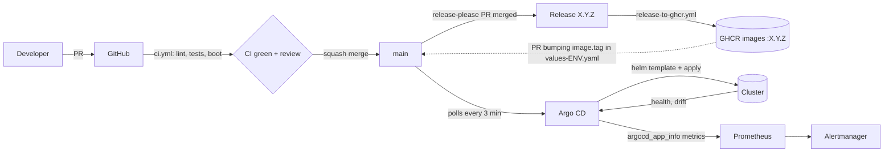

# GitOps with Argo CD

Git declares what runs in the cluster; Argo CD makes the cluster match it. Builds stay in
GitHub Actions: **CI builds and publishes images, Git changes declare which image and
configuration run, Argo CD applies them.** Argo CD never builds anything.

## Layout

```
deploy/argocd/
  Chart.yaml, values.yaml        "App of apps" chart: one AppProject + one Application per component
  envs/local.yaml                Environment overrides (one file per environment)
  root-local.yaml                Root Application for the environment (the only thing applied by hand)
  templates/project.yaml         AppProject: allowed repos and namespaces
  templates/observability.yaml   kube-prometheus-stack, traefik, loki, tempo, alloy (upstream chart + values from this repo)
  templates/app.yaml             The pixelwar chart from charts/pixelwar
  templates/alerts.yaml          Alerts on Argo CD sync and health
  argocd-values.yaml             Argo CD's own install values
deploy/k8s/observability/*.yaml  Values for each observability chart (shared with `just k8s-observability`)
deploy/k8s/pixelwar/values-*.yaml App values per environment
charts/pixelwar/                 App chart, alert rules and dashboard
```

## Workflow



| Change | Where | Delivered by |
|---|---|---|
| Application code | `backend/`, `frontend/` | PR -> merge -> release -> image on GHCR -> PR bumping `image.tag` in `values-<env>.yaml` -> Argo CD |
| Helm values, replicas, resources | `deploy/k8s/pixelwar/values-<env>.yaml` | PR -> merge -> Argo CD |
| App chart templates | `charts/pixelwar/templates/` | PR -> merge -> Argo CD (bump `version` in `Chart.yaml`) |
| Alert rules | `charts/pixelwar/files/alerts/*.yml` | PR -> merge -> Argo CD updates the PrometheusRule; the operator reloads Prometheus |
| Dashboards | `charts/pixelwar/files/dashboards/*.json` | PR -> merge -> Argo CD updates the ConfigMap; the Grafana sidecar reloads it |
| Observability config | `deploy/k8s/observability/<chart>.yaml` | PR -> merge -> Argo CD |
| Upstream chart versions | `deploy/argocd/values.yaml` (and `versions.env`) | PR -> merge -> Argo CD |
| Secrets | Never in Git | Created out of band (`just k8s-secrets`, or a secret manager operator) |

Alert rules and dashboards are plain files reviewed in the PR diff, and Compose loads the same
files, so they can be tried locally (`just up`) before merging.

## Environments and promotion

One root Application per environment (`root-<env>.yaml`) points the same `deploy/argocd`
chart at its `envs/<env>.yaml`. Only `local` (a kind cluster) exists today. To add one:

1. `deploy/k8s/pixelwar/values-<env>.yaml`: GHCR images with an explicit tag (`backend.image.tag: "1.2.0"`), `pullPolicy: IfNotPresent`, sizing.
2. `deploy/argocd/envs/<env>.yaml`: `env: <env>`, `app.valueFiles`, `destinationServer` for another cluster.
3. `deploy/argocd/root-<env>.yaml`: a copy of `root-local.yaml` with that values file.

Promotion is a pull request that copies the image tag (or a values change) from
`values-dev.yaml` to `values-prd.yaml` once dev is healthy. Everything tracks `main`;
there are no long-lived environment branches, which keeps the existing trunk-based
flow (short feature branches, squash merges, release-please tags).

## Install and bootstrap

```bash
just k8s-cluster k8s-secrets k8s-images     # cluster, secrets, local images (see docs/kubernetes.md)
just argocd-install                          # Argo CD
just argocd-bootstrap                        # root Application -> everything else, tracking main
just argocd-status                           # sync and health per application
just argocd-ui                               # UI on http://localhost:8443
```

`just argocd-bootstrap <branch>` makes the root and all children track a branch, to test a
GitOps change before merging. Run it again without an argument to go back to `main`.

The order is enforced with sync waves: kube-prometheus-stack (CRDs) in wave 0, Traefik, Loki,
Tempo, Alloy and the Argo CD alerts in wave 1, the app in wave 2 (it needs the Traefik and
Prometheus Operator CRDs). `argocd-values.yaml` restores the Application health check so a
wave waits for the previous one to be healthy.

## Drift, reconciliation and recovery

- **Detection:** Argo CD polls the repository (default every 3 minutes) and compares the
  rendered manifests with the live objects. *Refresh* in the UI forces it.
- **Reconciliation:** `automated.prune` deletes objects removed from Git; `selfHeal` reverts
  manual edits. Try it: `kubectl -n pixelwar scale deploy/pixelwar-backend --replicas=0`;
  Argo CD restores the declared replicas within seconds.
- **Failures:** a failed sync retries with backoff (5 tries, up to 3 min). The app shows
  `Degraded` or `OutOfSync`, and Prometheus alerts `ArgoCDAppUnhealthy` (5m) or
  `ArgoCDAppOutOfSync` (15m) go through Alertmanager like any other alert.
- **Recovery:** revert the commit (`git revert`) and merge; Argo CD rolls back to the
  previous state. Rolling back in the UI is temporary because auto-sync re-applies `main`.
  Stateful data (PVCs) is not touched by a rollback.

### A sync or rollout fails

1. `just argocd-status`, then the app in the UI: *Sync status* shows the failing resource and
   the API server's message (invalid manifest, missing CRD, immutable field).
2. If it synced but is `Degraded`: `kubectl -n pixelwar get pods` and
   [docs/kubernetes.md#troubleshoot-a-failing-deployment](kubernetes.md#troubleshoot-a-failing-deployment).
3. Grafana: the *Pixelwar* dashboard shows whether traffic is affected (backends up, 5xx,
   latency). Loki `{namespace="pixelwar"} | json | level="error"` and Kubernetes events show
   why; a trace of a failing request (`{ status = error }`) shows which dependency fails.
4. Fix forward with a new commit, or `git revert` the change.

Observability runs as separate Applications in its own namespace, so a broken app release
cannot take down the monitoring that diagnoses it.

## Security

- The repository is public, so Argo CD needs no Git credentials. A private fork needs a
  repository Secret (`argocd.argoproj.io/secret-type: repository`) created out of band.
- The AppProject limits sources to this repository and the four upstream chart repositories,
  and destinations to the `pixelwar`, `monitoring`, `traefik` and `kube-system` namespaces.
  It allows cluster-scoped resources because the charts install CRDs and ClusterRoles.
- The Argo CD UI is reachable only through port-forward. Change the initial admin password,
  or configure SSO, before exposing it.

## Limitations

- Argo CD is installed with Helm, not managed by itself.
- No image updater: tags are bumped by pull request. Argo CD Image Updater or a CI job that
  opens the bump PR are the natural next steps.
- `versions.env` duplicates the chart versions in `deploy/argocd/values.yaml` for the
  non-GitOps install path.
