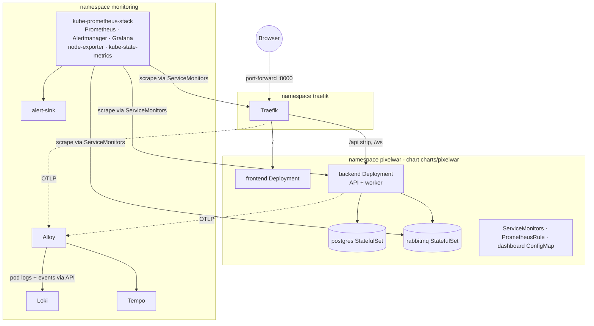

# Kubernetes

The app and its observability stack on a local [kind](https://kind.sigs.k8s.io/) cluster,
packaged with Helm. The same charts and values target any conformant cluster.

## Layout

```
charts/pixelwar/                 App chart (backend, frontend, dev Postgres + RabbitMQ, routing, monitoring)
  files/alerts/app.yml           Alert rules, shared with Compose
  files/alerts/host.yml          Host alerts, Compose only
  files/dashboards/pixelwar.json Grafana dashboard, shared with Compose
deploy/k8s/
  kind.yaml                      Local cluster definition
  pixelwar/values-local.yaml     App overrides for the local cluster
  observability/versions.env     Pinned upstream chart versions
  observability/*.yaml           Values for kube-prometheus-stack, loki, tempo, alloy, traefik
observability/compose/           Compose-only configuration of the same tools
```

## Architecture



Routing is identical to Compose: Traefik sends `/ws` and `/api/*` (prefix stripped) to the
backend and everything else to the frontend (an `IngressRoute` plus `Middleware` in the chart).

## Compose vs Kubernetes

| | Compose | Kubernetes |
|---|---|---|
| Images | Dev images, source mounted, hot reload | Production `Dockerfile` images (`just k8s-images` locally, GHCR otherwise) |
| Configuration | `.env` + `docker-compose.yml` | Helm values (`charts/pixelwar/values.yaml` + `deploy/k8s/pixelwar/values-*.yaml`) |
| Secrets | `.env` (git-ignored) | Kubernetes Secrets created out of band (`just k8s-secrets`) |
| Scrape discovery | Static targets in `prometheus.yml` | ServiceMonitors (Prometheus Operator) |
| Log collection | Alloy reads the Podman/Docker socket | Alloy reads pod logs and events through the Kubernetes API |
| Cluster metrics | Host only (node-exporter) | Nodes, pods, containers (kube-state-metrics, cAdvisor) |
| Host/pod alerts | `host.yml` | kube-prometheus-stack's built-in rules |
| Persistence | Named volumes | PVCs (default StorageClass) |
| Health | Compose healthchecks | startup, readiness and liveness probes on `/health` |
| Access | `127.0.0.1` ports | `just k8s-forward` (port-forward) |

Not reproduced in Compose: per-container CPU and memory (cAdvisor does not work reliably
with rootless Podman), Kubernetes events, and rolling updates.

## Prerequisites

`nix develop` provides `kind`, `kubectl`, `helm` and Podman. Otherwise install them plus
Docker or Podman. kind runs on rootless Podman (`KIND_EXPERIMENTAL_PROVIDER=podman` is set by
the recipes) but needs cgroup v2 with CPU delegation; see
[kind rootless](https://kind.sigs.k8s.io/docs/user/rootless/).

## Secrets

Nothing sensitive is in Git. The charts reference two Secrets:

| Secret | Namespace | Keys |
|---|---|---|
| `pixelwar-secrets` | `pixelwar` | `postgres-password`, `rabbitmq-password`, `admin-users` (optional) |
| `grafana-admin` | `monitoring` | `admin-user`, `admin-password` |

`just k8s-secrets` creates them with random values if they do not exist. For a shared cluster
use a secret manager integration (External Secrets Operator, Sealed Secrets) instead.

## Operate

```bash
just k8s-up                 # cluster + secrets + observability + images + app (first run: ~10 min)
just k8s-forward            # app :8000, Grafana :3001, Prometheus :9090, Alertmanager :9093

just k8s-images && kubectl -n pixelwar rollout restart deploy   # ship local code changes
just k8s-app --set backend.replicaCount=2                       # upgrade with a value change
just k8s-observability                                          # upgrade the observability stack
helm -n pixelwar history pixelwar                               # releases
helm -n pixelwar rollback pixelwar <revision>                   # roll back

kubectl -n pixelwar get pods,svc,pvc
just k8s-app-uninstall      # remove the app, keep its data
just k8s-cluster-delete     # remove everything
```

Grafana password: `kubectl -n monitoring get secret grafana-admin -o jsonpath='{.data.admin-password}' | base64 -d`.

## Validate offline

```bash
just k8s-validate           # helm lint + helm template | kubeconform (needs kubeconform)
```

## Troubleshoot a failing deployment

1. `kubectl -n pixelwar get pods` - `Pending` (no PVC/resources), `CrashLoopBackOff`, `ImagePullBackOff`?
2. `kubectl -n pixelwar describe pod <pod>` - events: probe failures, OOMKilled, scheduling.
3. `kubectl -n pixelwar logs <pod> --previous` - the crashed container's last output.
4. In Grafana, Loki: `{namespace="pixelwar"} | json | level="error"`, and
   `{job="loki.source.kubernetes_events"} |= "pixelwar"` for events that `describe` no
   longer shows.
5. Alerts: `KubePodCrashLooping`, `KubeDeploymentReplicasMismatch` and `PixelwarBackendDown`
   fire on their own; the alert-sink log (`kubectl -n monitoring logs deploy/alert-sink`)
   shows what was sent.

The observability stack runs in its own namespace and release, so it keeps working while
the app is failing.

## Production gaps

- Postgres and RabbitMQ are single-replica StatefulSets for dev; use managed services or
  operators (`postgres.enabled=false`, `external.*`).
- Loki and Tempo store data on local PVCs; use object storage for anything shared.
- No TLS or authentication on the ingress; Grafana is the only authenticated UI.
- One Alloy replica reads logs through the API server; use a DaemonSet on large clusters.
- No HorizontalPodAutoscaler: the worker is a single active consumer by design.
