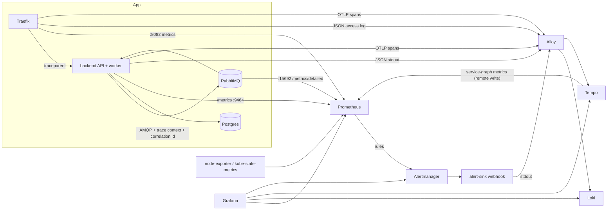

# Observability

Metrics, logs, traces and alerts for the whole stack, in Docker Compose and in Kubernetes.
Requirements come from the course subject, chapter **C08 - Monitoring, Logging, Tracing &
Alerting** (see [Requirements coverage](#requirements-coverage)).

## Toolchain

| Pillar | Tool | Why |
|---|---|---|
| Metrics | Prometheus (+ node-exporter; kube-state-metrics in Kubernetes) | Pull model, PromQL, the de facto standard; the subject suggests it |
| Dashboards | Grafana | One UI for metrics, logs and traces, with links between them |
| Logs | Loki | Indexes labels only, cheap for a local prototype, queried from Grafana |
| Traces | OpenTelemetry SDK -> Tempo | Vendor-neutral instrumentation (subject suggests OTel); Tempo stores traces on local disk |
| Agent | Grafana Alloy | One agent for both logs and OTLP traces, so there is a single pipeline per environment |
| Alerts | Prometheus rules -> Alertmanager -> webhook | Rules live in Git next to the dashboards; no paid service needed |

The subject recommends the cloud provider's native monitoring for the serverless app. This
repository runs the app as containers with no cloud account, so everything is self-hosted
and runs the same way on a laptop and in a cluster.

## Data flow



## Application instrumentation

The backend (`backend/src`) was instrumented for this; it previously had only `/health`
and plain-text `console` logs.

| File | What it adds |
|---|---|
| `telemetry.js` | OpenTelemetry SDK preloaded with `node --require`. Auto-instruments HTTP, Express, amqplib (propagates the trace context in AMQP headers, so API and worker spans join one trace) and Prisma (database spans). Off unless `OTEL_EXPORTER_OTLP_ENDPOINT` is set. |
| `log.js` | One JSON object per line: `time`, `level`, `service`, `message`, plus `trace_id` / `span_id` of the active span. |
| `metrics.js` | `prom-client` registry served on a **separate port** (`METRICS_PORT`, default 9464), so `/metrics` is never public through `/api`. |
| `app.js` | Correlation id: taken from `X-Correlation-Id` if well formed, otherwise generated; returned in the response header; set on the span; carried on the AMQP message. |
| `events.js` | Per-command metrics and logs; failed commands go to the `pixelwar.commands.dlq` queue instead of being dropped. |

### Metrics

| Metric | Meaning (subject vocabulary) |
|---|---|
| `pixelwar_http_request_duration_seconds{method,route,status}` | API requests: rate, errors (5xx), latency (proxy acknowledgement time) |
| `pixelwar_commands_total{type,outcome}` | Worker invocations and errors |
| `pixelwar_command_duration_seconds{type}` | Worker processing time |
| `pixelwar_command_queue_wait_seconds{type}` | **Message age**: time a command waited in the queue (RabbitMQ does not expose it) |
| `rabbitmq_detailed_queue_messages_ready{queue}` | **Queue depth** (from RabbitMQ's built-in Prometheus plugin) |
| `rabbitmq_detailed_queue_messages{queue="pixelwar.commands.dlq"}` | **DLQ count** |
| `process_*`, `nodejs_*` | Backend CPU, memory, event loop lag |
| `traefik_*` | Edge request rate and latency per router |
| `node_*`, `kube_*`, `container_*` | Host / cluster CPU, RAM, nodes, pods (Kubernetes adds kube-state-metrics and cAdvisor) |

Every scrape target carries a `component` label (`backend`, `rabbitmq`, `proxy`, ...) set by
the Compose scrape config and by the Kubernetes ServiceMonitors alike, so the alert rules
and the dashboard work unchanged in both environments.

### Logs

Example backend line:

```json
{"time":"2026-10-22T18:00:00.000Z","level":"info","service":"backend","message":"command processed",
 "correlation_id":"6f1c...","event_type":"pixel.draw","user_id":"bob","trace_id":"4bf9...","span_id":"00f0..."}
```

Alloy parses JSON lines, promotes `level` to a label, and stores `correlation_id` and
`trace_id` as Loki structured metadata (filterable without high-cardinality labels).
Non-JSON lines (Postgres, RabbitMQ, the frontend) are kept as-is. Labels: `service`
(Compose service name, or the pod's `app.kubernetes.io/component` in Kubernetes), plus
`namespace`, `pod` and `container` in Kubernetes. Kubernetes events are shipped too.

### Traces

`proxy` (Traefik) starts each trace and forwards `traceparent`. The backend continues it
through Express and Prisma, injects it into the AMQP message, and the worker's consume span
joins the same trace. So a draw shows `proxy -> POST /pixels -> db (quota) -> publish ->
consume -> db (upsert) -> publish event`.

**Gaps (not instrumented):** the browser frontend (no client-side tracing), the WebSocket
delivery to clients, and RabbitMQ/Postgres internals (they appear only as client spans).

## Start and stop (Compose)

The observability services are in the `monitoring` profile, so the everyday `just up -d`
stays small. Enable them explicitly:

```bash
just up -d --profile monitoring   # app + observability
just up -d                        # app only; telemetry is emitted but not collected
just down                         # stops both
```

## Access

| | Compose | Kubernetes (`just k8s-forward`) |
|---|---|---|
| Grafana | http://localhost:3001 (`GRAFANA_ADMIN_USER` / `GRAFANA_ADMIN_PASSWORD` from `.env`) | http://localhost:3001 (user `admin`, password from the `grafana-admin` secret) |
| Prometheus | http://localhost:9090 | http://localhost:9090 |
| Alertmanager | http://localhost:9093 | http://localhost:9093 |
| App | http://localhost:8000 | http://localhost:8000 |

Compose binds observability ports to `127.0.0.1` only; none of them have authentication
except Grafana.

**Is collection working?** Prometheus -> *Status -> Target health*: every target should be
`UP`. In Grafana, the *Pixelwar* dashboard is the home page; *Explore* gives raw access.

## Dashboard

`charts/pixelwar/files/dashboards/pixelwar.json` (shared by both environments):
backends up, request rate, 5xx ratio, p95 latency, DLQ count; requests by route; latency
p50/p95; commands by outcome; queue depth; message age vs processing time; backend CPU and
memory; backend warnings and errors from Loki. Kubernetes also gets kube-prometheus-stack's
built-in dashboards (*Kubernetes / Compute Resources / Cluster*, *Node Exporter / Nodes*,
...), which cover CPU, RAM, node and pod counts.

## Queries

LogQL (Grafana -> Explore -> Loki):

```logql
{service="backend"} | json | level="error"                      # backend errors
{service="backend"} | correlation_id="<id>"                     # one request, end to end
{service="backend"} | json | event_type="pixel.draw" | user_id="bob"
{service="proxy"} | json | DownstreamStatus >= 500              # 5xx at the edge
{service="alert-sink"}                                          # alert notifications received
{job="loki.source.kubernetes_events"} |= "pixelwar"             # Kubernetes events (k8s only)
```

TraceQL (Explore -> Tempo):

```traceql
{ resource.service.name = "backend" && span.correlation_id = "<id>" }
{ resource.service.name = "backend" && duration > 500ms }       # slow requests
{ status = error }                                              # failing spans
```

PromQL: see the dashboard panels (*Edit* shows each query).

### Investigate a slow request

1. Dashboard -> *API latency*: check whether p95 rose and on which route (*Requests by route*).
2. Tempo -> `{ resource.service.name = "backend" && duration > 500ms }`, open a trace: the
   longest child span shows where time went (Prisma query, broker publish, ...).
3. *Logs for this span* jumps to the matching Loki lines (same `trace_id`).
4. If the delay is between API and worker, check *Message age* on the dashboard: the queue
   is backing up.

### Find a failing dependency

`{ status = error }` in Tempo, or Grafana -> Explore -> Tempo -> *Service Graph*: the
service map (built from span metrics) shows error rate per edge between services.

## Alerts

Rules: `charts/pixelwar/files/alerts/app.yml` (both environments) and `host.yml` (Compose only;
kube-prometheus-stack ships equivalent node and pod rules, including `KubePodCrashLooping`,
`KubeDeploymentReplicasMismatch`, `NodeFilesystemSpaceFillingUp` and `CPUThrottlingHigh`).
Alertmanager groups by `alertname` and `component`, waits 30s before the first notification,
and repeats every 4h while firing.

| Alert | Severity | Type | Meaning | First steps | Recovery |
|---|---|---|---|---|---|
| <a id="pixelwarbackenddown"></a>`PixelwarBackendDown` | critical | app | No backend scrapeable for 1m | `just logs backend` / `kubectl -n pixelwar describe pod -l app.kubernetes.io/component=backend`; check db and rabbitmq health | Resolves once one backend answers scrapes |
| <a id="pixelwarhigherrorrate"></a>`PixelwarHighErrorRate` | critical | app | >5% of API requests are 5xx for 5m | Loki `{service="backend"} \| json \| level="error"`; follow `trace_id` | Resolves when ratio drops for one evaluation |
| <a id="pixelwarhighlatency"></a>`PixelwarHighLatency` | warning | app | p95 API latency >500ms for 10m | See *Investigate a slow request* | Self-resolving |
| <a id="pixelwarqueuebacklog"></a>`PixelwarQueueBacklog` | warning | app | p95 message age >30s or >1000 pending for 5m | Is the worker consuming? (`rabbitmq_detailed_queue_consumers`); worker errors in Loki | Drains on its own once the worker keeps up |
| <a id="pixelwardeadletters"></a>`PixelwarDeadLetters` | warning | app | Failed commands parked in the DLQ | Read the message in the RabbitMQ UI (`x-error` header, `correlation_id`), then the logs for that id | Purge or replay the DLQ (RabbitMQ UI -> Queues -> `pixelwar.commands.dlq`) |
| <a id="pixelwarbackendmemoryhigh"></a>`PixelwarBackendMemoryHigh` | warning | resource | Backend RSS >400MiB for 10m (limit 512Mi) | Dashboard *Backend memory*; large PNG renders are the usual suspect | Restart the pod / raise `backend.resources.limits.memory` |
| <a id="hostmemorylow"></a>`HostMemoryLow` | warning | resource | <10% host memory available (Compose) | `podman stats` | Free memory or stop services |
| <a id="hostdisklow"></a>`HostDiskLow` | warning | resource | <10% free on a host filesystem (Compose) | `podman system df` | Prune images/volumes |

Thresholds are starting points for a local prototype, not tuned on production traffic.

### Trigger and verify an alert

Stopping the backend fires `PixelwarBackendDown` (critical, 1m):

```bash
# Compose
podman compose stop backend        # or: docker compose stop backend
# Kubernetes
kubectl -n pixelwar scale deploy/pixelwar-backend --replicas=0
```

1. Prometheus -> *Alerts*: `PixelwarBackendDown` goes *pending*, then *firing* after 1m.
2. Alertmanager UI lists it ~30s later (`group_wait`).
3. The notification reaches the sink: Grafana -> Explore -> Loki -> `{service="alert-sink"}`
   (or `just logs alert-sink` / `kubectl -n monitoring logs deploy/alert-sink`).
4. Restore with `podman compose start backend` / `--replicas=1`; a `"status":"resolved"`
   notification follows.

`PixelwarDeadLetters` can be triggered by publishing an unparseable message to
`pixelwar.commands.fifo` from the RabbitMQ UI (*Queues -> Publish message*, payload `oops`).

### Notifications

The default receiver, `alert-sink`, only logs the webhook payload, so the path can be
verified without credentials. To send to a real channel such as Discord, add a receiver
whose URL comes from a file or secret, never from Git:

```yaml
receivers:
  - name: discord
    discord_configs:
      - webhook_url_file: /etc/alertmanager/secrets/discord-webhook-url
```

In Kubernetes, put the URL in a Secret, list it under
`alertmanager.alertmanagerSpec.secrets`, and it is mounted at
`/etc/alertmanager/secrets/<secret>/<key>`.

## Load and scaling

`api-scripts/draw_pixels.py` (set `RATE_LIMIT=0`) or large brush strokes generate load.
Watch *Requests / s*, *Queue depth* and *Message age* rise and drain. In Kubernetes,
`kubectl -n pixelwar scale deploy/pixelwar-backend --replicas=3` adds API capacity; the
worker is deliberately a single active consumer (`x-single-active-consumer`, ordering), so
draining speed does not scale with replicas.

## Persistence, retention, resources

| Data | Compose volume | Kubernetes PVC | Retention |
|---|---|---|---|
| Metrics | `prometheus-data` | 5Gi | 7d (`PROMETHEUS_RETENTION`) / 7d or 4GB |
| Logs | `loki-data` | 5Gi | 168h, compactor deletes older |
| Traces | `tempo-data` | 5Gi | 72h |
| Alert silences | `alertmanager-data` | 1Gi | - |
| Grafana state | `grafana-data` | 1Gi | - |

Container logs on disk are rotated by the container runtime (Podman/Docker `log-opts`,
kubelet `containerLogMaxSize`); Loki holds the searchable copy. `just down` keeps all data;
`just nuke` deletes it. Resource requests and limits for Kubernetes are in the values
files under `deploy/k8s/observability/`.

## Requirements coverage

| C08 requirement | Status |
|---|---|
| Cluster CPU, RAM, node count, pod count | Kubernetes: kube-prometheus-stack dashboards. Compose: host only (node-exporter) |
| Self-hosted runner activity, node autoscaling | **Not covered**: this repository has no runners or managed cluster (subject §02 foundation) |
| App invocations, errors, latency | `pixelwar_http_*`, `pixelwar_commands_total`, `pixelwar_command_duration_seconds` |
| Queue depth, message age, DLQ | RabbitMQ metrics, `pixelwar_command_queue_wait_seconds`, `pixelwar.commands.dlq` |
| Storage read/write errors | Partial: Prisma spans in traces; no dedicated DB metrics (postgres-exporter is a follow-up) |
| Structured logs with `correlation_id`, `trace_id`, `user_id`, function, event type | Yes (`service` stands for the function name) |
| Correlation id from the entry point through the workers | Yes, over HTTP and AMQP |
| Searchable logs and traces | Loki and Tempo in Grafana, linked both ways |
| Resource and application alerts, routed | Yes; routed to a local webhook sink by default |
| Demonstrate scaling under load | Load script plus dashboard; worker scaling is limited by design |
