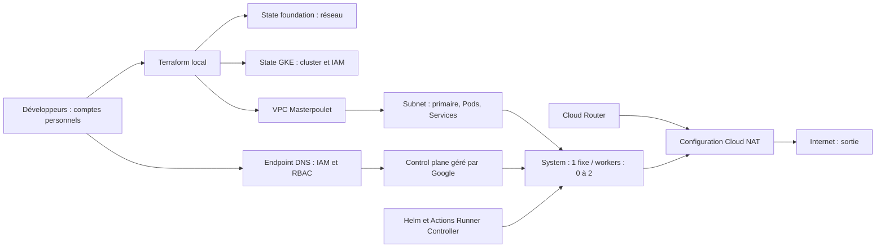

# Infrastructure Masterpoulet — guide de l'équipe

Guide des trois développeurs du projet EPITECH **Masterpoulet Serverless Pixel
War**. Commencer ici, puis consulter le [réseau foundation](foundation/README.md)
ou le [cluster GKE](gke/README.md).

> Les blocs d'application et de destruction sont des procédures opérateur,
> pas des instructions à exécuter maintenant. Coordonner toute intervention
> avec l'équipe et relire un plan récent avant de modifier GCP.

## Table des matières

- [Objectif et architecture](#objectif-et-architecture)
- [Organisation du dépôt](#organisation-du-dépôt)
- [État observé et environnements](#état-observé-et-environnements)
- [Comprendre Terraform](#comprendre-terraform)
- [Référence des commandes](#référence-des-commandes)
- [Préparer Windows et les identités](#préparer-windows-et-les-identités)
- [Sélectionner la stack et le backend](#sélectionner-la-stack-et-le-backend)
- [Planifier et déployer](#planifier-et-déployer)
- [Détruire et recréer](#détruire-et-recréer)
- [Sécurité et travail en équipe](#sécurité-et-travail-en-équipe)
- [Coûts et économies](#coûts-et-économies)
- [Diagnostic](#diagnostic)
- [Sources et limites](#sources-et-limites)

## Objectif et architecture

Nous conservons les clusters GKE existants pour ARC et les runners GitHub
Actions, avec un pool système permanent et un pool workers à la demande.
L'application Pixel War reste dans la stack serverless, indépendante de GKE.
La [procédure de migration](gke/README.md) impose DEV avant PROD, une validation
de capacité et un plan approuvé à chaque étape. Aucun apply n'a été exécuté
lors de cette préparation du 20 novembre 2026.

L'**Infrastructure as Code** décrit les ressources dans des fichiers versionnés.
Terraform compare cette description au réel et prépare les changements. Une
revue Git permet de comprendre les choix et de reproduire un environnement,
au lieu de dépendre d'une suite de clics connue d'une seule personne.

| Outil | Rôle |
| --- | --- |
| GCP | Fournit réseaux, stockage, machines et service Kubernetes managé. |
| Terraform | Décrit et gère les ressources GCP, avec un state partagé. |
| Docker | Construit et exécute des conteneurs ; Compose démarre l'application locale. |
| Kubernetes / GKE | Orchestre les Pods ; Google gère le control plane GKE. |
| Helm | Installe le controller ARC et le runner scale set par deux releases Terraform. |
| GitHub Actions | Exécute les workflows sur des runners ; ARC est installé ; les workflows courants utilisent ubuntu-latest. |



Router–NAT est une relation de configuration : Cloud Router n'est pas une VM
traversée par chaque paquet. Le statut réel des composants est précisé ci-dessous.

## Organisation du dépôt

Fichiers à partager, hors caches, states et plans locaux :

```text
infra/
├── README.md
├── foundation/
│   ├── README.md, AUDIT.md
│   ├── backend.tf, providers.tf, variables.tf
│   ├── main.tf, router.tf, nat.tf, outputs.tf
│   ├── dev.tfvars, prod.tfvars, default.tfvars
│   ├── backends/dev.hcl, backends/prod.hcl
│   ├── check.py, scripts/check.py
│   └── .gitignore, .terraform.lock.hcl
├── bootstrap/              # WIF + bucket de state, appliqué à la main
├── serverless/functions/   # Discord bot et fonctions, voir son README
└── gke/
    ├── README.md
    ├── backend.tf, providers.tf, variables.tf
    ├── network.tf, iam.tf, cluster.tf, node-pool.tf, outputs.tf
    ├── dev.tfvars, prod.tfvars
    ├── backends/dev.hcl, backends/prod.hcl
    └── .gitignore, .terraform.lock.hcl
```

Les noms séparés par des virgules désignent des fichiers distincts. Chaque
sous-dossier est un module racine autonome, appelé ici une **stack**. `infra/`
n'a pas de `.tf` racine : un plan lancé là ne gère pas les deux stacks.

| Stack | Propriété Terraform | Dépendance |
| --- | --- | --- |
| foundation | VPC, subnet et secondaires, Cloud Router, Cloud NAT | Projet, API et bucket existants. |
| gke | Cluster, pool, compte de service et attribution IAM des nœuds | Lit le VPC/subnet existants avec des data sources. |
| bootstrap | APIs IAM, bucket de state, compte de déploiement et Workload Identity Federation GitHub | Application **manuelle** avec un compte propriétaire du projet ; hors CI. Voir [bootstrap/README.md](bootstrap/README.md). |
| runners | Contrôleur et scale set ARC des runners GitHub | Cluster GKE existant. |
| serverless/functions | Cloud Functions du bot Discord et du web | Projet et APIs ; indépendant de foundation, GKE et runners. |

`gke` et `runners` ne sont pas déployés par `terraform-deploy.yml` (voir `.github/workflows`). La CI les planifie avec les autres racines : le compte de déploiement doit pouvoir lire leur state et leurs ressources IAM.

Créer **foundation puis GKE** ; supprimer **GKE puis foundation**. Les states
séparés permettent de supprimer le cluster après une démo sans supprimer le
réseau. GKE ne lit pas le state foundation et n'en prend pas la propriété.
Les verrous sont distincts : ne pas modifier les deux stacks simultanément.

## État observé et environnements

**Audit en lecture seule du 20 novembre 2026**, depuis origin/main 69153ff.

| Élément | DEV | PROD |
| --- | --- | --- |
| Projet | masterpoulet-dev | masterpoulet-prod |
| Région / zone | europe-west1 / europe-west1-b | europe-west3 / europe-west3-b |
| VPC et secondaires | Présents ; foundation sans changement | Présents ; Router/NAT absents, plan foundation : 2 créations |
| Cluster GKE | masterpoulet-dev-gke, RUNNING | masterpoulet-prod-gke, RUNNING |
| Pool déployé | github-runners, 1 e2-standard-2, autoscaling 1–2 | Identique |
| ARC déployé | arc + masterpoulet-dev-gke, charts 0.15.0 | arc + masterpoulet-prod-gke, charts 0.15.0 |
| Application Kubernetes | Aucun pod applicatif observé | Aucun pod applicatif observé |
| Proposition | system : 1 e2-medium ; workers : total 0–2 | Identique, tests bloqués tant que sortie Internet non validée |

Les inventaires Cloud Run/Functions PROD sont vides ; la disponibilité publique
de Pixel War n'a pas pu être attestée sans URL de référence. Aucun composant
applicatif, réseau ou IAM n'est modifié pour réduire les coûts GKE.
Voir le [dimensionnement et les plans](gke/README.md#plans-et-drift).

### Backends et states

Tous utilisent le workspace **default**. Les chemins backend sont relatifs à
chaque stack. Toutes les stacks utilisent `prod` pour PROD (fichiers et préfixes GCS).

| Stack / cible | Fichier backend | Bucket | Préfixe | Objet state |
| --- | --- | --- | --- | --- |
| foundation DEV | backends/dev.hcl | masterpoulet_bucket | foundation/dev | foundation/dev/default.tfstate |
| foundation PROD | backends/prod.hcl | masterpoulet_prod_bucket | foundation/prod | foundation/prod/default.tfstate |
| GKE DEV | backends/dev.hcl | masterpoulet_bucket | gke/dev | gke/dev/default.tfstate |
| GKE PROD | backends/prod.hcl | masterpoulet_prod_bucket | gke/prod | gke/prod/default.tfstate |

Les states GKE et runners DEV/PROD ont été lus pour vérifier leurs propriétaires.
Les states foundation restent séparés. Les buckets sont en europe-west1,
indépendamment de la région des nœuds ; ne jamais déplacer ni recréer les states.
Un state présent ne prouve pas l'absence de dérive : produire un plan récent.
Les backends runners utilisent les mêmes buckets avec runners/dev et runners/prod.

## Comprendre Terraform

Une **ressource** est un objet créé, modifié ou supprimé par la stack, comme
`google_compute_subnetwork.subnet`. Une **data source** lit sans gérer :
`data.google_compute_subnetwork.subnet` permet à GKE de réutiliser le réseau.

Le **provider** traduit le code en appels API. Les stacks utilisent
`hashicorp/google`, contrainte `~> 7.0`, verrouillé en `7.46.1` par leurs
`.terraform.lock.hcl`. Ces locks et leurs empreintes doivent être versionnés.
Terraform CLI doit respecter `>= 1.6.0, < 2.0.0`.

Les **variables** décrivent les paramètres dans `variables.tf`. `dev.tfvars`
et `prod.tfvars` apportent les valeurs ; ils nécessitent
`-var-file` et ne sont pas chargés automatiquement. Les providers définissent
`project = var.project_id` : le projet actif gcloud ne remplace pas cette valeur.

Le **backend GCS** partage le **state**, correspondance entre adresses Terraform
et objets GCP. `backend.tf` est générique ; `init -backend-config` sélectionne
bucket et préfixe. Le state peut contenir des données sensibles : ne pas le
publier, le modifier à la main, ni en créer un second pour les mêmes objets.

GCS fournit le **verrouillage** : une opération incompatible attend ou échoue.
Utiliser `-lock-timeout=60s` et prévenir l'équipe ; ne pas contourner le lock avec
`-lock=false` ou `force-unlock`. Un verrou ne résout pas les conflits Git et ne
synchronise pas deux stacks différentes.

Les **outputs** donnent des informations issues du state : identifiant de
subnet, nom du cluster ou commande de connexion. Ils peuvent manquer après un
échec partiel. Le code est l'**état souhaité**, GCP l'**état réel**. `plan` lit
les écarts : `+` création, `~` modification en place, `-` suppression, `-/+`
remplacement. `validate` ne teste pas tous les droits, quotas ou règles GCP.

## Référence des commandes

Ces commandes sont **natives de Terraform**, pas des scripts de l'équipe.
Exemples depuis la stack et le backend DEV correctement sélectionnés :

| Commande | Utilité / quand | Effet GCP | Précaution |
| --- | --- | --- | --- |
| `terraform init -reconfigure -backend-config="backends/dev.hcl"` | Initialisation ou changement explicite de backend. | Accès au stockage d'état ; providers installés localement, aucun cluster déployé. | Vérifier bucket/préfixe ; aucune migration entre stacks/environnements. |
| `terraform fmt` | Formater avant revue. | Aucun, fichiers locaux modifiés. | Relire le diff. |
| `terraform fmt -check -recursive` | Contrôler le format, notamment en CI. | Aucun. | Corriger localement si échec. |
| `terraform validate` | Vérifier types et cohérence après init. | Aucun déploiement. | Succès différent d'un apply garanti. |
| `terraform plan -var-file="dev.tfvars"` | Prévisualiser les changements. | Lectures API et lock temporaire du state. | Plan périssable, pas une application. |
| `terraform apply` | Planifier puis demander confirmation d'application. | Écrit dans GCP et le state. | Relire la cible avant de répondre yes. |
| `terraform apply "dev.tfplan"` | Appliquer un plan enregistré/revu. | Écrit dans GCP et le state. | **Pas de nouvelle demande yes** ; confirmer avant la commande. |
| `terraform plan -destroy -var-file="dev.tfvars"` | Prévisualiser le nettoyage. | Lecture, aucune suppression. | Examiner sauvegardes et dépendances. |
| `terraform destroy -var-file="dev.tfvars"` | Calculer puis confirmer une suppression. | Supprime les ressources gérées. | Destructif ; préférer le plan enregistré décrit plus bas. |
| `terraform state list` | Lister les adresses du state choisi. | Lit le state. | Ne prouve pas la santé des ressources. |
| `terraform state show google_service_account.nodes` | Inspecter cette identité dans le state GKE. | Lit le state. | Sortie potentiellement sensible. |
| `terraform show "dev.tfplan"` | Relire le plan local ; sans argument, afficher le state. | Aucun déploiement. | Ne pas publier son contenu sensible. |
| `terraform output` | Consulter les outputs. | Lit le state. | -json/-raw peuvent révéler des valeurs sensibles. |

Un plan réussi renvoie 0 même s'il prévoit des changements. Avec
`-detailed-exitcode` : **0 = aucun changement, 1 = erreur, 2 = changements prévus**.
Les procédures ci-dessous n'utilisent pas cette option, pour garder un contrôle
simple des erreurs PowerShell.

## Préparer Windows et les identités

Installer [Git pour Windows](https://git-scm.com/download/win),
[Terraform CLI](https://developer.hashicorp.com/terraform/install) et
[Google Cloud CLI](https://docs.cloud.google.com/sdk/docs/install-sdk).
Avec Chocolatey **déjà installé**, l'installation Terraform peut se faire dans
un PowerShell administrateur :

```powershell
choco install terraform
```

Sans Chocolatey, décompresser le ZIP Windows officiel de Terraform et ajouter
le dossier de terraform.exe au PATH. Respecter la version requise par le dépôt.
Pour Google Cloud CLI, lancer l'installateur officiel, suivre les écrans et
rouvrir PowerShell :

```powershell
$gcloudInstaller = Join-Path $env:TEMP 'GoogleCloudSDKInstaller.exe'
Invoke-WebRequest -Uri 'https://dl.google.com/dl/cloudsdk/channels/rapid/GoogleCloudSDKInstaller.exe' -OutFile $gcloudInstaller
Start-Process -FilePath $gcloudInstaller -Wait
```

Installer les outils Kubernetes et vérifier le PATH :

```powershell
gcloud.cmd components install kubectl gke-gcloud-auth-plugin
if ($LASTEXITCODE -ne 0) { throw 'Installation Kubernetes incomplète.' }
git --version
terraform version
gcloud.cmd version
kubectl version --client
gke-gcloud-auth-plugin --version
```

Si le gestionnaire de composants gcloud est désactivé par le distributeur,
suivre son mode d'installation et le [guide d'accès GKE](https://docs.cloud.google.com/kubernetes-engine/docs/how-to/cluster-access-for-kubectl).
Helm, Docker et Nix ne sont pas nécessaires pour seulement consulter GKE ou
utiliser Terraform. Docker/Podman sert au développement local ; Helm viendra
avec les runners.

`gcloud.cmd` est le lanceur Windows du même CLI. Il évite l'erreur « running
scripts is disabled » de gcloud.ps1, sans abaisser la politique PowerShell globale.
Chaque développeur s'authentifie avec **son propre compte** :

```powershell
gcloud.cmd auth login
if ($LASTEXITCODE -ne 0) { throw 'Connexion gcloud échouée.' }
gcloud.cmd auth application-default login
if ($LASTEXITCODE -ne 0) { throw 'Connexion ADC Terraform échouée.' }
gcloud.cmd auth list
gcloud.cmd config get-value project
```

`auth login` sert à gcloud et, par défaut, au plugin kubectl ; `application-default
login` fournit les **ADC de Terraform**. Les identités peuvent différer : vérifier
les deux en cas de 403. Ne pas afficher les jetons ni copier les credentials
d'un collègue. Les commandes passent --project explicitement : aucun changement
du projet gcloud actif n'est nécessaire.

| Besoin | Accès à faire attribuer par un administrateur |
| --- | --- |
| State et locks | Accès objets au bucket concerné, typiquement roles/storage.objectAdmin au niveau bucket ; accès métadonnées si nécessaire à l'outil. |
| Réseau foundation | Permissions Compute réseau/subnet/Router/NAT adaptées ; Network Admin seulement si ce périmètre est approuvé. |
| GKE | Permissions de gestion GKE et iam.serviceAccounts.actAs sur le compte des nœuds. |
| Création du compte et son IAM | Permissions de création d'identité et de modification ciblée de politique IAM ; opération réservée aux personnes autorisées. |
| Kubernetes | Accès au cluster, container.clusters.connect pour le DNS, puis autorisations sur les ressources Kubernetes voulues. |
| Facturation | Permissions distinctes pour consulter coûts, budgets et crédits. |

**Ne pas donner Owner à tous.** L'accès au bucket n'autorise pas à créer un
cluster, et l'accès Kubernetes ne donne pas accès au state. Les stacks n'activent
pas d'API, ne lient pas la facturation et ne créent pas les buckets. Un opérateur
autorisé doit vérifier ces prérequis, les quotas et les agents de service GKE.
Ne pas contourner une erreur de permission en ajoutant des rôles généraux.

## Sélectionner la stack et le backend

Le couple est **backends/dev.hcl + dev.tfvars** pour DEV. Pour PROD, foundation
et GKE utilisent **backends/prod.hcl + prod.tfvars**. Depuis un dossier du dépôt, choisir la cible
dans les deux premières lignes. Ce bloc initialise **GKE DEV** :

```powershell
$infraStack = 'gke'       # foundation ou gke
$infraEnv = 'dev'         # dev ou prod
if ($infraStack -notin @('foundation', 'gke') -or $infraEnv -notin @('dev', 'prod')) { throw 'Cible invalide.' }
$infraRepoRoot = git rev-parse --show-toplevel
if ($LASTEXITCODE -ne 0) { throw 'Ouvrir un dossier du dépôt Git.' }
Set-Location (Join-Path $infraRepoRoot "infra/$infraStack")
Get-Content "backends/$infraEnv.hcl"
Get-Content "$infraEnv.tfvars"
terraform init -reconfigure -backend-config="backends/$infraEnv.hcl" -input=false
if ($LASTEXITCODE -ne 0) { throw 'Échec init : ne pas continuer.' }
$infraWorkspace = terraform workspace show
if ($LASTEXITCODE -ne 0 -or $infraWorkspace -ne 'default') { throw 'Workspace default requis.' }
$infraBackend = Get-Content .terraform/terraform.tfstate -Raw | ConvertFrom-Json
$infraBucket = if ($infraEnv -eq 'dev') { 'masterpoulet_bucket' } else { 'masterpoulet_prod_bucket' }
if ($infraBackend.backend.type -ne 'gcs' -or $infraBackend.backend.config.bucket -ne $infraBucket -or $infraBackend.backend.config.prefix -ne "$infraStack/$infraEnv") { throw 'Backend inattendu.' }
terraform state list
if ($LASTEXITCODE -ne 0) { throw 'Lecture du state impossible.' }
```

Le fichier local `.terraform/terraform.tfstate` est la métadonnée du backend,
pas le state distant des ressources. N'afficher que ses champs utiles, jamais
d'éventuels credentials. `-reconfigure` choisit un backend sans migrer les états.
Ne jamais accepter une migration DEV→PROD ou foundation→GKE.

Pour passer à PROD dans la même stack, revoir les valeurs et réexécuter le bloc
de sélection avec `$infraEnv = 'prod'`, après accord de l'équipe. Le couple
complet dépend de la stack :

```powershell
terraform init -reconfigure -backend-config="backends/$infraEnv.hcl" -input=false
if ($LASTEXITCODE -ne 0) { throw 'Échec init PROD.' }
terraform plan -var-file="$infraEnv.tfvars" -input=false -lock-timeout=60s
```

Avant les procédures génériques suivantes, réexécuter le bloc de sélection avec
$infraEnv='prod' si PROD est voulu : ne pas laisser les variables PowerShell sur DEV.
Le retour DEV exige dev.hcl puis dev.tfvars. Un nouveau terminal ne réinitialise
pas le backend mémorisé dans `.terraform/`. Un mauvais couple peut viser un
mauvais projet ou enregistrer des ressources dans le mauvais state : **arrêter au
premier doute**, sans apply, import ou modification manuelle du state.

## Planifier et déployer

### Vérifier et enregistrer le plan

Après le bloc de sélection, conserver son dossier et ses variables :

```powershell
terraform fmt -recursive
if ($LASTEXITCODE -ne 0) { throw 'Formatage échoué.' }
terraform fmt -check -recursive
if ($LASTEXITCODE -ne 0) { throw 'Format incorrect.' }
terraform validate
if ($LASTEXITCODE -ne 0) { throw 'Configuration invalide.' }
$infraPlanFile = "$infraEnv.tfplan"
terraform plan -var-file="$infraEnv.tfvars" -input=false -lock-timeout=60s -out="$infraPlanFile"
if ($LASTEXITCODE -ne 0) { throw 'Plan échoué : aucune application.' }
terraform show "$infraPlanFile"
if ($LASTEXITCODE -ne 0) { throw 'Plan illisible.' }
```

Relire projet, zone, créations, coûts, modifications et remplacements. Sur une
infrastructure alignée, attendre « No changes ». Sur une stack vide, le plan
crée les ressources définies ; les anciens résumés ne sont pas des résultats
universels. Refaire le plan si code, state ou contexte a changé.

### Appliquer après revue et coordination

Le plan enregistré contient les variables ; ne pas ajouter -var-file à son apply.
Le binaire **ne redemande pas yes** : cette procédure ajoute une confirmation :

```powershell
$infraConfirmation = Read-Host "Appliquer le plan revu $infraStack/$infraEnv ? Saisir APPLIQUER"
if ($infraConfirmation -cne 'APPLIQUER') { throw 'Application annulée.' }
terraform apply "$infraPlanFile"
if ($LASTEXITCODE -ne 0) { throw 'Application partielle possible : inspecter le state et refaire un plan.' }
terraform output
terraform state list
terraform plan -var-file="$infraEnv.tfvars" -input=false -lock-timeout=60s
```

Sans plan enregistré, `terraform apply -var-file="dev.tfvars"` calcule un plan
et demande normalement yes. Ne pas utiliser -auto-approve. Un apply n'est pas
une transaction : un compte peut être créé alors que le cluster échoue. Lire
le state, corriger l'erreur et refaire un plan, sans supprimer manuellement les
objets déjà gérés. Compléter par les contrôles GCP/Kubernetes des guides de stack.

## Détruire et recréer

### Prévisualiser le nettoyage

Pour économiser après une démo, sélectionner **gke / dev** dans le bloc init.
Prévenir l'équipe, arrêter les jobs, sauvegarder les données et examiner PVC/PV,
Services LoadBalancer, Ingress et IP réservées. Leur cycle de vie peut différer
des ressources Terraform. Depuis la stack sélectionnée :

```powershell
$infraDestroyPlan = "$infraEnv-destroy.tfplan"
terraform plan -destroy -var-file="$infraEnv.tfvars" -input=false -lock-timeout=60s -out="$infraDestroyPlan"
if ($LASTEXITCODE -ne 0) { throw 'Échec plan de nettoyage.' }
terraform show "$infraDestroyPlan"
```

Aucune suppression n'a encore lieu. Vérifier stack, projet et dépendances.
DEV GKE a deletion_protection=false ; cela autorise une suppression sans la
déclencher. PROD garde true : il faut une modification revue puis appliquée
de la protection avant de pouvoir supprimer le cluster via Terraform.

### Confirmer et supprimer

```powershell
$infraConfirmation = Read-Host "SUPPRESSION de $infraStack/$infraEnv : saisir SUPPRIMER"
if ($infraConfirmation -cne 'SUPPRIMER') { throw 'Suppression annulée.' }
terraform apply "$infraDestroyPlan"
if ($LASTEXITCODE -ne 0) { throw 'Nettoyage incomplet : examiner dépendances et state.' }
terraform state list
```

La commande native `terraform destroy -var-file="dev.tfvars"` calcule aussi
un plan de suppression et demande normalement yes. Le plan enregistré sépare
mieux préparation et revue. **Supprimer GKE avant foundation** ; ne pas supprimer
foundation si d'autres utilisateurs dépendent du réseau. Conserver les buckets,
les états et leurs versions pour l'historique et la récupération.

### Recréer

Conserver code et buckets, puis reprendre init/plan/apply ordinaires : foundation
si nécessaire, ensuite GKE. Revoir API, quotas, IAM et plages IP. Générer un
nouveau plan après destruction, sans réutiliser un ancien binaire. Ne pas créer
un state parallèle pour adopter des objets déjà gérés. Renouveler kubeconfig
avec get-credentials --dns-endpoint après recréation GKE.

## Sécurité et travail en équipe

Comptes Google, ADC, kubeconfig, outils et backend sélectionné sont locaux à
chaque PC. Les ressources et states sont partagés. Un collègue accède directement
à GCP : le PC du créateur peut être éteint.

Ne jamais committer clés privées, jetons, credentials, kubeconfig, .env, states,
caches .terraform/ ou plans. Les .gitignore excluent states et *.tfplan, mais
ne filtrent pas tous les secrets possibles. Les tfvars actuels ne contiennent
que de la configuration publique. Versionner les locks providers. Marquer une
variable sensitive n'autorise pas à publier sa valeur dans un tfvars.

**IAM GCP** contrôle projets, API et ressources ; **RBAC Kubernetes** contrôle
les opérations sur Pods, namespaces, etc. GKE intègre aussi certaines permissions
IAM pour Kubernetes : vérifier les droits effectifs des deux côtés. Le service
account des nœuds n'est pas un compte Kubernetes ni une identité générale de job.

| Fédération | Situation du dépôt |
| --- | --- |
| Workload Identity Federation pour GKE | Configurée sur cluster et Metadata Server du pool ; liaisons/droits des futurs workloads à définir. |
| OIDC GitHub→GCP pour Terraform | Aucun pool/provider de fédération ou workflow de déploiement Terraform GCP défini ici ; étape future, sans clés longues durées. |
| OIDC de signature d'images | release-to-ghcr utilise id-token: write et cosign keyless ; ce n'est pas une connexion Terraform à GCP. |

Suivre [CONTRIBUTOR.md](../CONTRIBUTOR.md) : branche feat/..., PR vers main,
Conventional Commits, issue liée, revue et CI verte. Ne pas travailler directement
sur main. [AGENTS.md](../AGENTS.md) impose notamment GitNexus avant édition et
l'analyse des changements avant commit. Une branche Git n'isole pas les ressources
GCP : annoncer cible, plan et fenêtre d'intervention à l'équipe avant apply/destroy.

Le trailer **Signed-off-by** (`git commit -s`) est une attestation, pas une
signature cryptographique. Celle-ci peut utiliser GPG ou SSH. Le dépôt documente
SSH avec gpg.format=ssh et commit.gpgsign=true : le nom de l'option Git n'impose
pas une clé GPG. Les hooks exigent le sign-off et avertissent si la signature
est désactivée. Configurer sa propre clé selon CONTRIBUTOR.md ; ne partager
aucune clé privée. Aucun commit n'est nécessaire pour consulter le cluster.

La CI actuelle découvre les roots possédant un backend, puis exécute fmt,
init, validate et des plans distants DEV/PROD avec OIDC. Le déploiement
terraform-deploy.yml vise foundation et serverless/functions ; il ne déploie
pas GKE/runners. Un push de cette branche ne correspond pas à son déclencheur
de déploiement par tag. Aucun workflow n'a été lancé manuellement pour ce travail.
Les tests Terraform mockés GKE/runners se lancent localement avec
terraform test -var-file=dev.tfvars puis prod.tfvars. Les tests applicatifs
restent indépendants de la migration.

## Coûts et économies

**Le repos reste payant.** Modèle indicatif USD hors taxes/remises/crédits,
730 h/mois, une IP NAT par projet, 30 GiB pd-standard par nœud, aucune VM Spot.
Les tarifs régionaux proviennent du catalogue officiel Compute Engine consulté
le 20 novembre 2026 : cœur E2 DEV 0,02399337 USD/h, RAM 0,00321609 USD/GiB/h ;
PROD 0,02810370 et 0,00376602. Le modèle e2-medium retient une capacité soutenue
d'un vCPU et 4 GiB, contre deux vCPU et 8 GiB pour e2-standard-2.
Vérifier le SKU partagé exact dans le devis Billing avant engagement ; ce calcul
est une estimation, pas une facture contractuelle.

| Tarif retenu | DEV europe-west1 | PROD europe-west3 |
| --- | --- | --- |
| e2-medium / h | 0,03685773 | 0,04316778 |
| e2-standard-2 / h | 0,07371546 | 0,08633556 |
| pd-standard / GiB-mois | 0,040 | 0,048 |
| Système VM / mois | 26,91 | 31,51 |
| Système disque / mois | 1,20 | 1,44 |
| Gestion GKE / mois | 73,00 | 73,00 |
| NAT permanent : VM + une IP / mois | 1,022 + 3,65 | 1,022 + 3,65 après restauration |

Comparaison **à sortie NAT fonctionnelle dans les deux environnements**.
Avant : un worker permanent, deux en usage intensif. Après : un système permanent
plus H heures-nœud workers ; un worker 1 h/j donne H=30, 4 h/j H=120.
Intensif signifie deux workers 24h/24, H=1460. Deux workers pendant 1 h/j
consomment H=60. La période de démarrage et les délais de scale-down s'ajoutent
à ces heures utiles.

| Usage | DEV avant → après | PROD avant → après | Cumul avant → après | Économie cumulée |
| --- | --- | --- | --- | --- |
| Inactif, H=0 | 132,68 → 105,78 | 142,14 → 110,62 | 274,82 → 216,40 | 58,42/mois |
| 1 h/j, H=30 | 132,68 → 108,08 | 142,14 → 113,32 | 274,82 → 221,40 | 53,42/mois |
| 4 h/j, H=120 | 132,68 → 114,99 | 142,14 → 121,39 | 274,82 → 236,38 | 38,44/mois |
| Intensif, H=1460 | 188,72 → 217,85 | 207,62 → 241,60 | 396,34 → 459,45 | surcoût 63,11/mois |

Le PROD réellement observé **n'a pas de NAT** : son sous-total actuel au repos
est environ 137,47 USD, soit 270,15 USD cumulés avec DEV. Restaurer sa sortie
ajoute environ 4,67 USD/mois au repos (5,69 avec deux VM permanentes).
Comparer cet état réel au futur fonctionnel donne environ **53,75 USD/mois**
d'économie cumulée au repos. Ne pas présenter le NAT absent comme une économie
permettant des runners fonctionnels.

Formules après, avant autres consommations :
DEV = 105,77814 + 0,07675930 × H ;
PROD avec NAT = 110,62448 + 0,08970816 × H.
Elles incluent VM, boot disks proratisés, gestion GKE et NAT/IP.
La séparation économise à faible utilisation, mais ajoute le système aux
workers à forte utilisation ; ce n'est pas une garantie de dépense maximale.

**Ajouter aux sous-totaux** :

- 0,045 USD/GiB traité par NAT, plus sortie Internet selon destination/volume ;
  une IP NAT supplémentaire ajoute 3,65 USD/mois. Cloud Router n'est pas une VM.
- GCS : octets des states/versions/snapshots/sources, opérations et transferts
  entre régions (notamment état PROD europe-west1 et workloads europe-west3).
- Artifact Registry, images, logs/métriques au-delà des franchises, secrets,
  Firestore, Pub/Sub, scheduler, API Gateway et fonctions selon leurs usages.
  Aucun volume réel ni export Billing n'est disponible pour chiffrer ces postes
  sans inventer une facture. Ils ne disparaissent pas avec les workers.
- Un crédit GKE éligible peut retirer jusqu'à 74,40 USD par **compte de
  facturation**, pas par projet. Ne pas le compter deux fois si DEV/PROD partagent
  le compte ; crédits étudiants et promotionnels ne sont pas supposés acquis.

L'inventaire Compute ne montre qu'une VM et son disque de 30 GiB par projet,
sans disque Compute détaché. DEV possède une IP NAT en usage et plusieurs
buckets de sources historiques (europe-west1, west2, west9), en plus des states
et snapshots : vérifier propriétaire, versions et rétention avant tout
nettoyage. Aucun doublon/bucket n'est supprimé automatiquement.
L'inventaire PROD ne montre que son bucket de state.
Les exports de facturation, la taille de tous les objets, le trafic et les
autres services facturables ne sont pas audités exhaustivement.

Sources : [catalogue tarifaire officiel](https://docs.cloud.google.com/billing/v1/how-tos/catalog-api),
[Compute](https://cloud.google.com/products/compute/pricing/general-purpose),
[disques](https://cloud.google.com/compute/disks-image-pricing),
[GKE](https://cloud.google.com/kubernetes-engine/pricing),
[NAT](https://cloud.google.com/nat/pricing),
[GCS](https://cloud.google.com/storage/pricing).
Les budgets sont des alertes, pas des coupe-circuits automatiques.

## Diagnostic

| Symptôme | Cause probable | Action |
| --- | --- | --- |
| Init réussit dans un dossier vide, rien à planifier | Commande lancée dans infra/ au lieu d'une stack. | Se placer dans infra/foundation/, infra/gke/ ou infra/serverless/functions/, lire les .tf. |
| Backend initialization required / backend différent | Métadonnées locales d'une autre cible. | Relire backend/tfvars et init -reconfigure ; aucune migration. |
| Plan créant/supprimant tout dans un projet inattendu | Mauvais state, mauvais couple, application partielle. | Stopper et vérifier bucket/préfixe/workspace/projet ; aucun reset/import improvisé. |
| Validate échoue | Provider absent, mauvais type, bloc ou conflit. | Lire l'erreur, corriger ou initialiser les providers. |
| Validate réussit mais plan/apply échoue | API, IAM, quotas ou règle GCP non testés localement. | Traiter la cause d'origine ; un plan partiel n'est pas un succès. |
| SERVICE_DISABLED | API absente dans le projet visé. | APIs & Services ; activation par opérateur autorisé. Une liste en erreur n'est pas une liste vide. |
| 403 / Permission denied | Mauvaise identité gcloud/ADC ou droits insuffisants. | Vérifier identités et permissions ciblées, sans donner Owner. |
| Bucket absent/inaccessible | Mauvais nom, accès refusé ou bucket manquant. | Comparer au tableau des backends ; ne pas créer de remplacement improvisé. |
| State verrouillé | Processus ou collègue actif. | Attendre/coordonner ; ne pas forcer le déverrouillage sans diagnostic. |
| Too many command line arguments | Argument mal transmis sous PowerShell. | Copier les options entre guillemets, par exemple -var-file="dev.tfvars". |
| Running scripts is disabled pour gcloud | Sélection du lanceur gcloud.ps1. | Utiliser gcloud.cmd. |
| Plugin GKE introuvable | gke-gcloud-auth-plugin absent du PATH. | Installer le composant, rouvrir le terminal, tester --version. |
| kubectl timeout / Unauthorized / Forbidden | Endpoint, identité ou autorisations. | Suivre le [diagnostic Kubernetes](gke/README.md#diagnostic-kubernetes). |
| node_locations contient la zone d'origine | Zone principale répétée dans node_locations du cluster zonal. | Cluster : location=var.zone sans node_locations ; pool : [var.zone]. Voir [le détail](gke/README.md#erreur-node_locations). |

## Sources et limites

Les noms viennent des fichiers réels ; l'état daté vient d'inventaires GCP et
lectures de states. Aucun secret n'est reproduit. Cet audit documentaire n'a
pas configuré kubectl, lancé de test de charge, installé de runner ni vérifié
les réseaux extérieurs aux projets ou les droits des trois comptes de l'équipe.

[foundation/AUDIT.md](foundation/AUDIT.md) conserve les étapes et erreurs des
22–23 octobre 2026 : ses constats anciens ne décrivent pas tous le statut actuel.
Les anciens plans sont documentés comme historiques, jamais comme garanties.

Références : [backend GCS et verrouillage](https://developer.hashicorp.com/terraform/language/backend/gcs),
[commandes Terraform](https://developer.hashicorp.com/terraform/cli/commands),
[accès kubectl](https://docs.cloud.google.com/kubernetes-engine/docs/how-to/cluster-access-for-kubectl).
