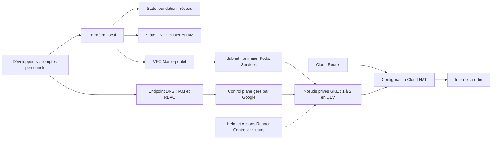

# Infrastructure Masterpoulet — guide de l'équipe

Guide des trois développeurs du projet EPITECH **Masterpoulet Serverless Pixel
War**. Commencer ici, puis consulter le [réseau foundation](foundation/README.md)
ou le [cluster GKE](gke/README.md).

> Les blocs d'application et de destruction sont des procédures opérateur,
> pas des instructions à exécuter maintenant. Coordonner toute intervention
> avec l'équipe et relire un plan récent avant de modifier GCP.

## Table des matières

- [Objectif et architecture](#objectif-et-architecture)
- [Organisation du dépôt](#organisation-du-dépôt)
- [État observé et environnements](#état-observé-et-environnements)
- [Comprendre Terraform](#comprendre-terraform)
- [Référence des commandes](#référence-des-commandes)
- [Préparer Windows et les identités](#préparer-windows-et-les-identités)
- [Sélectionner la stack et le backend](#sélectionner-la-stack-et-le-backend)
- [Planifier et déployer](#planifier-et-déployer)
- [Détruire et recréer](#détruire-et-recréer)
- [Sécurité et travail en équipe](#sécurité-et-travail-en-équipe)
- [Coûts et économies](#coûts-et-économies)
- [Diagnostic](#diagnostic)
- [Sources et limites](#sources-et-limites)

## Objectif et architecture

Nous gérons un réseau GCP et un petit cluster destiné aux **futurs runners GitHub
Actions**. Ce cluster n'est pas la cible d'hébergement de l'application
serverless. Le dépôt contient aussi l'application et sa stack Docker Compose
locale ; cela ne prouve pas un déploiement cloud de l'application.

L'**Infrastructure as Code** décrit les ressources dans des fichiers versionnés.
Terraform compare cette description au réel et prépare les changements. Une
revue Git permet de comprendre les choix et de reproduire un environnement,
au lieu de dépendre d'une suite de clics connue d'une seule personne.

| Outil | Rôle |
| --- | --- |
| GCP | Fournit réseaux, stockage, machines et service Kubernetes managé. |
| Terraform | Décrit et gère les ressources GCP, avec un state partagé. |
| Docker | Construit et exécute des conteneurs ; Compose démarre l'application locale. |
| Kubernetes / GKE | Orchestre les Pods ; Google gère le control plane GKE. |
| Helm | Installe des ensembles de ressources Kubernetes via des charts ; étape future pour les runners. |
| GitHub Actions | Exécute les workflows sur des runners ; l'intégration des runners GKE reste à faire. |



Router–NAT est une relation de configuration : Cloud Router n'est pas une VM
traversée par chaque paquet. Le statut réel des composants est précisé ci-dessous.

## Organisation du dépôt

Fichiers à partager, hors caches, states et plans locaux :

```text
infra/
├── README.md
├── foundation/
│   ├── README.md, AUDIT.md
│   ├── backend.tf, providers.tf, variables.tf
│   ├── main.tf, router.tf, nat.tf, outputs.tf
│   ├── dev.tfvars, prd.tfvars
│   ├── backends/dev.hcl, backends/prd.hcl
│   ├── check.ps1
│   └── .gitignore, .terraform.lock.hcl
└── gke/
    ├── README.md
    ├── backend.tf, providers.tf, variables.tf
    ├── network.tf, iam.tf, cluster.tf, node-pool.tf, outputs.tf
    ├── dev.tfvars, prd.tfvars
    ├── backends/dev.hcl, backends/prd.hcl
    └── .gitignore, .terraform.lock.hcl
```

Les noms séparés par des virgules désignent des fichiers distincts. Chaque
sous-dossier est un module racine autonome, appelé ici une **stack**. `infra/`
n'a pas de `.tf` racine : un plan lancé là ne gère pas les deux stacks.

| Stack | Propriété Terraform | Dépendance |
| --- | --- | --- |
| foundation | VPC, subnet et secondaires, Cloud Router, Cloud NAT | Projet, API et bucket existants. |
| gke | Cluster, pool, compte de service et attribution IAM des nœuds | Lit le VPC/subnet existants avec des data sources. |

Créer **foundation puis GKE** ; supprimer **GKE puis foundation**. Les states
séparés permettent de supprimer le cluster après une démo sans supprimer le
réseau. GKE ne lit pas le state foundation et n'en prend pas la propriété.
Les verrous sont distincts : ne pas modifier les deux stacks simultanément.

## État observé et environnements

**Audit en lecture seule du 23 octobre 2026**, sans nouveau plan ni déploiement
pour cette documentation. Ces observations remplacent les anciennes indications
de préparation ; elles ne constituent pas une garantie permanente de santé.

| Élément | DEV | PROD |
| --- | --- | --- |
| Projet | `masterpoulet-dev` | `masterpoulet-prod` |
| Réseau | VPC/subnet, Router et NAT présents et référencés dans le state | VPC/subnet, Router et NAT présents et référencés dans le state |
| Plages secondaires | Présentes : Pods `10.16.0.0/21`, Services `10.16.8.0/24` | Déclarées : `10.32.0.0/21`, `10.32.8.0/24` ; absentes du subnet observé |
| GKE | `masterpoulet-dev-gke`, RUNNING, `europe-west1-b`, un nœud observé | Configuration préparée ; inventaire bloqué par l'API GKE désactivée, déploiement non confirmé |
| Autoscaling | Activé 1–2 sur github-runners ; montée/descente non démontrée par cet audit | Exemple à revoir avant utilisation |
| Helm / runners | Aucun déploiement défini par ces stacks ; fonctionnement non vérifié | Non définis par ces stacks |

### Backends et states

Tous utilisent le workspace **default**. Les chemins backend sont relatifs à
chaque stack, et les noms PROD s'écrivent **prd**, pas prod.

| Stack / cible | Fichier backend | Bucket | Préfixe | Objet state |
| --- | --- | --- | --- | --- |
| foundation DEV | backends/dev.hcl | masterpoulet_bucket | foundation/dev | foundation/dev/default.tfstate |
| foundation PROD | backends/prd.hcl | masterpoulet_prod_bucket | foundation/prd | foundation/prd/default.tfstate |
| GKE DEV | backends/dev.hcl | masterpoulet_bucket | gke/dev | gke/dev/default.tfstate |
| GKE PROD | backends/prd.hcl | masterpoulet_prod_bucket | gke/prd | gke/prd/default.tfstate |

Les trois premiers objets ont été trouvés. Aucun objet trouvé à `gke/prd` ne
prouve pas l'absence de ressources hors Terraform. Les buckets existent, ne sont
gérés par aucune des deux stacks et restent après destruction. Leur région
`europe-west1` est indépendante des subnets. Versioning et protections avaient
été vérifiés lors de leur préparation ; contrôler leur configuration actuelle
avant toute modification. Un state présent n'est pas une preuve d'absence de dérive.

## Comprendre Terraform

Une **ressource** est un objet créé, modifié ou supprimé par la stack, comme
`google_compute_subnetwork.subnet`. Une **data source** lit sans gérer :
`data.google_compute_subnetwork.subnet` permet à GKE de réutiliser le réseau.

Le **provider** traduit le code en appels API. Les stacks utilisent
`hashicorp/google`, contrainte `~> 7.0`, verrouillé en `7.46.1` par leurs
`.terraform.lock.hcl`. Ces locks et leurs empreintes doivent être versionnés.
Terraform CLI doit respecter `>= 1.6.0, < 2.0.0`.

Les **variables** décrivent les paramètres dans `variables.tf`. `dev.tfvars`
et `prd.tfvars` apportent les valeurs ; sous ces noms, ils nécessitent
`-var-file` et ne sont pas chargés automatiquement. Les providers définissent
`project = var.project_id` : le projet actif gcloud ne remplace pas cette valeur.

Le **backend GCS** partage le **state**, correspondance entre adresses Terraform
et objets GCP. `backend.tf` est générique ; `init -backend-config` sélectionne
bucket et préfixe. Le state peut contenir des données sensibles : ne pas le
publier, le modifier à la main, ni en créer un second pour les mêmes objets.

GCS fournit le **verrouillage** : une opération incompatible attend ou échoue.
Utiliser `-lock-timeout=60s` et prévenir l'équipe ; ne pas contourner le lock avec
`-lock=false` ou `force-unlock`. Un verrou ne résout pas les conflits Git et ne
synchronise pas deux stacks différentes.

Les **outputs** donnent des informations issues du state : identifiant de
subnet, nom du cluster ou commande de connexion. Ils peuvent manquer après un
échec partiel. Le code est l'**état souhaité**, GCP l'**état réel**. `plan` lit
les écarts : `+` création, `~` modification en place, `-` suppression, `-/+`
remplacement. `validate` ne teste pas tous les droits, quotas ou règles GCP.

## Référence des commandes

Ces commandes sont **natives de Terraform**, pas des scripts de l'équipe.
Exemples depuis la stack et le backend DEV correctement sélectionnés :

| Commande | Utilité / quand | Effet GCP | Précaution |
| --- | --- | --- | --- |
| `terraform init -reconfigure -backend-config="backends/dev.hcl"` | Initialisation ou changement explicite de backend. | Accès au stockage d'état ; providers installés localement, aucun cluster déployé. | Vérifier bucket/préfixe ; aucune migration entre stacks/environnements. |
| `terraform fmt` | Formater avant revue. | Aucun, fichiers locaux modifiés. | Relire le diff. |
| `terraform fmt -check -recursive` | Contrôler le format, notamment en CI. | Aucun. | Corriger localement si échec. |
| `terraform validate` | Vérifier types et cohérence après init. | Aucun déploiement. | Succès différent d'un apply garanti. |
| `terraform plan -var-file="dev.tfvars"` | Prévisualiser les changements. | Lectures API et lock temporaire du state. | Plan périssable, pas une application. |
| `terraform apply` | Planifier puis demander confirmation d'application. | Écrit dans GCP et le state. | Relire la cible avant de répondre yes. |
| `terraform apply "dev.tfplan"` | Appliquer un plan enregistré/revu. | Écrit dans GCP et le state. | **Pas de nouvelle demande yes** ; confirmer avant la commande. |
| `terraform plan -destroy -var-file="dev.tfvars"` | Prévisualiser le nettoyage. | Lecture, aucune suppression. | Examiner sauvegardes et dépendances. |
| `terraform destroy -var-file="dev.tfvars"` | Calculer puis confirmer une suppression. | Supprime les ressources gérées. | Destructif ; préférer le plan enregistré décrit plus bas. |
| `terraform state list` | Lister les adresses du state choisi. | Lit le state. | Ne prouve pas la santé des ressources. |
| `terraform state show google_service_account.nodes` | Inspecter cette identité dans le state GKE. | Lit le state. | Sortie potentiellement sensible. |
| `terraform show "dev.tfplan"` | Relire le plan local ; sans argument, afficher le state. | Aucun déploiement. | Ne pas publier son contenu sensible. |
| `terraform output` | Consulter les outputs. | Lit le state. | -json/-raw peuvent révéler des valeurs sensibles. |

Un plan réussi renvoie 0 même s'il prévoit des changements. Avec
`-detailed-exitcode` : **0 = aucun changement, 1 = erreur, 2 = changements prévus**.
Les procédures ci-dessous n'utilisent pas cette option, pour garder un contrôle
simple des erreurs PowerShell.

## Préparer Windows et les identités

Installer [Git pour Windows](https://git-scm.com/download/win),
[Terraform CLI](https://developer.hashicorp.com/terraform/install) et
[Google Cloud CLI](https://docs.cloud.google.com/sdk/docs/install-sdk).
Avec Chocolatey **déjà installé**, l'installation Terraform peut se faire dans
un PowerShell administrateur :

```powershell
choco install terraform
```

Sans Chocolatey, décompresser le ZIP Windows officiel de Terraform et ajouter
le dossier de terraform.exe au PATH. Respecter la version requise par le dépôt.
Pour Google Cloud CLI, lancer l'installateur officiel, suivre les écrans et
rouvrir PowerShell :

```powershell
$gcloudInstaller = Join-Path $env:TEMP 'GoogleCloudSDKInstaller.exe'
Invoke-WebRequest -Uri 'https://dl.google.com/dl/cloudsdk/channels/rapid/GoogleCloudSDKInstaller.exe' -OutFile $gcloudInstaller
Start-Process -FilePath $gcloudInstaller -Wait
```

Installer les outils Kubernetes et vérifier le PATH :

```powershell
gcloud.cmd components install kubectl gke-gcloud-auth-plugin
if ($LASTEXITCODE -ne 0) { throw 'Installation Kubernetes incomplète.' }
git --version
terraform version
gcloud.cmd version
kubectl version --client
gke-gcloud-auth-plugin --version
```

Si le gestionnaire de composants gcloud est désactivé par le distributeur,
suivre son mode d'installation et le [guide d'accès GKE](https://docs.cloud.google.com/kubernetes-engine/docs/how-to/cluster-access-for-kubectl).
Helm, Docker et Nix ne sont pas nécessaires pour seulement consulter GKE ou
utiliser Terraform. Docker/Podman sert au développement local ; Helm viendra
avec les runners.

`gcloud.cmd` est le lanceur Windows du même CLI. Il évite l'erreur « running
scripts is disabled » de gcloud.ps1, sans abaisser la politique PowerShell globale.
Chaque développeur s'authentifie avec **son propre compte** :

```powershell
gcloud.cmd auth login
if ($LASTEXITCODE -ne 0) { throw 'Connexion gcloud échouée.' }
gcloud.cmd auth application-default login
if ($LASTEXITCODE -ne 0) { throw 'Connexion ADC Terraform échouée.' }
gcloud.cmd auth list
gcloud.cmd config get-value project
```

`auth login` sert à gcloud et, par défaut, au plugin kubectl ; `application-default
login` fournit les **ADC de Terraform**. Les identités peuvent différer : vérifier
les deux en cas de 403. Ne pas afficher les jetons ni copier les credentials
d'un collègue. Les commandes passent --project explicitement : aucun changement
du projet gcloud actif n'est nécessaire.

| Besoin | Accès à faire attribuer par un administrateur |
| --- | --- |
| State et locks | Accès objets au bucket concerné, typiquement roles/storage.objectAdmin au niveau bucket ; accès métadonnées si nécessaire à l'outil. |
| Réseau foundation | Permissions Compute réseau/subnet/Router/NAT adaptées ; Network Admin seulement si ce périmètre est approuvé. |
| GKE | Permissions de gestion GKE et iam.serviceAccounts.actAs sur le compte des nœuds. |
| Création du compte et son IAM | Permissions de création d'identité et de modification ciblée de politique IAM ; opération réservée aux personnes autorisées. |
| Kubernetes | Accès au cluster, container.clusters.connect pour le DNS, puis autorisations sur les ressources Kubernetes voulues. |
| Facturation | Permissions distinctes pour consulter coûts, budgets et crédits. |

**Ne pas donner Owner à tous.** L'accès au bucket n'autorise pas à créer un
cluster, et l'accès Kubernetes ne donne pas accès au state. Les stacks n'activent
pas d'API, ne lient pas la facturation et ne créent pas les buckets. Un opérateur
autorisé doit vérifier ces prérequis, les quotas et les agents de service GKE.
Ne pas contourner une erreur de permission en ajoutant des rôles généraux.

## Sélectionner la stack et le backend

Le couple est **backends/dev.hcl + dev.tfvars** pour DEV, et
**backends/prd.hcl + prd.tfvars** pour PROD. Depuis un dossier du dépôt, choisir
la cible dans les deux premières lignes. Ce bloc initialise **GKE DEV** :

```powershell
$infraStack = 'gke'       # foundation ou gke
$infraEnv = 'dev'         # dev ou prd
if ($infraStack -notin @('foundation', 'gke') -or $infraEnv -notin @('dev', 'prd')) { throw 'Cible invalide.' }
$infraRepoRoot = git rev-parse --show-toplevel
if ($LASTEXITCODE -ne 0) { throw 'Ouvrir un dossier du dépôt Git.' }
Set-Location (Join-Path $infraRepoRoot "infra/$infraStack")
Get-Content "backends/$infraEnv.hcl"
Get-Content "$infraEnv.tfvars"
terraform init -reconfigure -backend-config="backends/$infraEnv.hcl" -input=false
if ($LASTEXITCODE -ne 0) { throw 'Échec init : ne pas continuer.' }
$infraWorkspace = terraform workspace show
if ($LASTEXITCODE -ne 0 -or $infraWorkspace -ne 'default') { throw 'Workspace default requis.' }
$infraBackend = Get-Content .terraform/terraform.tfstate -Raw | ConvertFrom-Json
$infraBucket = if ($infraEnv -eq 'dev') { 'masterpoulet_bucket' } else { 'masterpoulet_prod_bucket' }
if ($infraBackend.backend.type -ne 'gcs' -or $infraBackend.backend.config.bucket -ne $infraBucket -or $infraBackend.backend.config.prefix -ne "$infraStack/$infraEnv") { throw 'Backend inattendu.' }
terraform state list
if ($LASTEXITCODE -ne 0) { throw 'Lecture du state impossible.' }
```

Le fichier local `.terraform/terraform.tfstate` est la métadonnée du backend,
pas le state distant des ressources. N'afficher que ses champs utiles, jamais
d'éventuels credentials. `-reconfigure` choisit un backend sans migrer les états.
Ne jamais accepter une migration DEV→PROD ou foundation→GKE.

Pour passer à PROD dans la même stack, revoir les valeurs puis utiliser le
couple complet, après accord de l'équipe :

```powershell
terraform init -reconfigure -backend-config="backends/prd.hcl" -input=false
if ($LASTEXITCODE -ne 0) { throw 'Échec init PROD.' }
terraform plan -var-file="prd.tfvars" -input=false -lock-timeout=60s
```

Avant les procédures génériques suivantes, réexécuter le bloc de sélection avec
$infraEnv='prd' si PROD est voulu : ne pas laisser les variables PowerShell sur DEV.
Le retour DEV exige dev.hcl puis dev.tfvars. Un nouveau terminal ne réinitialise
pas le backend mémorisé dans `.terraform/`. Un mauvais couple peut viser un
mauvais projet ou enregistrer des ressources dans le mauvais state : **arrêter au
premier doute**, sans apply, import ou modification manuelle du state.

## Planifier et déployer

### Vérifier et enregistrer le plan

Après le bloc de sélection, conserver son dossier et ses variables :

```powershell
terraform fmt -recursive
if ($LASTEXITCODE -ne 0) { throw 'Formatage échoué.' }
terraform fmt -check -recursive
if ($LASTEXITCODE -ne 0) { throw 'Format incorrect.' }
terraform validate
if ($LASTEXITCODE -ne 0) { throw 'Configuration invalide.' }
$infraPlanFile = "$infraEnv.tfplan"
terraform plan -var-file="$infraEnv.tfvars" -input=false -lock-timeout=60s -out="$infraPlanFile"
if ($LASTEXITCODE -ne 0) { throw 'Plan échoué : aucune application.' }
terraform show "$infraPlanFile"
if ($LASTEXITCODE -ne 0) { throw 'Plan illisible.' }
```

Relire projet, zone, créations, coûts, modifications et remplacements. Sur une
infrastructure alignée, attendre « No changes ». Sur une stack vide, le plan
crée les ressources définies ; les anciens résumés ne sont pas des résultats
universels. Refaire le plan si code, state ou contexte a changé.

### Appliquer après revue et coordination

Le plan enregistré contient les variables ; ne pas ajouter -var-file à son apply.
Le binaire **ne redemande pas yes** : cette procédure ajoute une confirmation :

```powershell
$infraConfirmation = Read-Host "Appliquer le plan revu $infraStack/$infraEnv ? Saisir APPLIQUER"
if ($infraConfirmation -cne 'APPLIQUER') { throw 'Application annulée.' }
terraform apply "$infraPlanFile"
if ($LASTEXITCODE -ne 0) { throw 'Application partielle possible : inspecter le state et refaire un plan.' }
terraform output
terraform state list
terraform plan -var-file="$infraEnv.tfvars" -input=false -lock-timeout=60s
```

Sans plan enregistré, `terraform apply -var-file="dev.tfvars"` calcule un plan
et demande normalement yes. Ne pas utiliser -auto-approve. Un apply n'est pas
une transaction : un compte peut être créé alors que le cluster échoue. Lire
le state, corriger l'erreur et refaire un plan, sans supprimer manuellement les
objets déjà gérés. Compléter par les contrôles GCP/Kubernetes des guides de stack.

## Détruire et recréer

### Prévisualiser le nettoyage

Pour économiser après une démo, sélectionner **gke / dev** dans le bloc init.
Prévenir l'équipe, arrêter les jobs, sauvegarder les données et examiner PVC/PV,
Services LoadBalancer, Ingress et IP réservées. Leur cycle de vie peut différer
des ressources Terraform. Depuis la stack sélectionnée :

```powershell
$infraDestroyPlan = "$infraEnv-destroy.tfplan"
terraform plan -destroy -var-file="$infraEnv.tfvars" -input=false -lock-timeout=60s -out="$infraDestroyPlan"
if ($LASTEXITCODE -ne 0) { throw 'Échec plan de nettoyage.' }
terraform show "$infraDestroyPlan"
```

Aucune suppression n'a encore lieu. Vérifier stack, projet et dépendances.
DEV GKE a deletion_protection=false ; cela autorise une suppression sans la
déclencher. PROD garde true : il faut une modification revue puis appliquée
de la protection avant de pouvoir supprimer le cluster via Terraform.

### Confirmer et supprimer

```powershell
$infraConfirmation = Read-Host "SUPPRESSION de $infraStack/$infraEnv : saisir SUPPRIMER"
if ($infraConfirmation -cne 'SUPPRIMER') { throw 'Suppression annulée.' }
terraform apply "$infraDestroyPlan"
if ($LASTEXITCODE -ne 0) { throw 'Nettoyage incomplet : examiner dépendances et state.' }
terraform state list
```

La commande native `terraform destroy -var-file="dev.tfvars"` calcule aussi
un plan de suppression et demande normalement yes. Le plan enregistré sépare
mieux préparation et revue. **Supprimer GKE avant foundation** ; ne pas supprimer
foundation si d'autres utilisateurs dépendent du réseau. Conserver les buckets,
les états et leurs versions pour l'historique et la récupération.

### Recréer

Conserver code et buckets, puis reprendre init/plan/apply ordinaires : foundation
si nécessaire, ensuite GKE. Revoir API, quotas, IAM et plages IP. Générer un
nouveau plan après destruction, sans réutiliser un ancien binaire. Ne pas créer
un state parallèle pour adopter des objets déjà gérés. Renouveler kubeconfig
avec get-credentials --dns-endpoint après recréation GKE.

## Sécurité et travail en équipe

Comptes Google, ADC, kubeconfig, outils et backend sélectionné sont locaux à
chaque PC. Les ressources et states sont partagés. Un collègue accède directement
à GCP : le PC du créateur peut être éteint.

Ne jamais committer clés privées, jetons, credentials, kubeconfig, .env, states,
caches .terraform/ ou plans. Les .gitignore excluent states et *.tfplan, mais
ne filtrent pas tous les secrets possibles. Les tfvars actuels ne contiennent
que de la configuration publique. Versionner les locks providers. Marquer une
variable sensitive n'autorise pas à publier sa valeur dans un tfvars.

**IAM GCP** contrôle projets, API et ressources ; **RBAC Kubernetes** contrôle
les opérations sur Pods, namespaces, etc. GKE intègre aussi certaines permissions
IAM pour Kubernetes : vérifier les droits effectifs des deux côtés. Le service
account des nœuds n'est pas un compte Kubernetes ni une identité générale de job.

| Fédération | Situation du dépôt |
| --- | --- |
| Workload Identity Federation pour GKE | Configurée sur cluster et Metadata Server du pool ; liaisons/droits des futurs workloads à définir. |
| OIDC GitHub→GCP pour Terraform | Aucun pool/provider de fédération ou workflow de déploiement Terraform GCP défini ici ; étape future, sans clés longues durées. |
| OIDC de signature d'images | release-to-ghcr utilise id-token: write et cosign keyless ; ce n'est pas une connexion Terraform à GCP. |

Suivre [CONTRIBUTOR.md](../CONTRIBUTOR.md) : branche feat/..., PR vers main,
Conventional Commits, issue liée, revue et CI verte. Ne pas travailler directement
sur main. [AGENTS.md](../AGENTS.md) impose notamment GitNexus avant édition et
l'analyse des changements avant commit. Une branche Git n'isole pas les ressources
GCP : annoncer cible, plan et fenêtre d'intervention à l'équipe avant apply/destroy.

Le trailer **Signed-off-by** (`git commit -s`) est une attestation, pas une
signature cryptographique. Celle-ci peut utiliser GPG ou SSH. Le dépôt documente
SSH avec gpg.format=ssh et commit.gpgsign=true : le nom de l'option Git n'impose
pas une clé GPG. Les hooks exigent le sign-off et avertissent si la signature
est désactivée. Configurer sa propre clé selon CONTRIBUTOR.md ; ne partager
aucune clé privée. Aucun commit n'est nécessaire pour consulter le cluster.

Le job Terraform de [ci.yml](../.github/workflows/ci.yml) exécute
`fmt -check -recursive -diff infra/`, puis `init -backend=false` et validate
pour les modules dont les .tf sont **suivis par Git**. Il n'exécute aucun plan
GCP ou apply et ne valide ni les permissions ni les coûts réels. Un fichier
non suivi n'est pas disponible dans le checkout CI. Les workflows de release
construisent/publient les images GHCR ; ils ne prouvent pas l'utilisation de
runners GKE. Ne pas modifier la CI pour contourner une erreur locale.

## Coûts et économies

**Des nœuds sans jobs restent facturables.** Le minimum de 1 interdit une descente
à zéro par le cluster autoscaler. La limite actuelle 1–2 réduit la capacité
persistante mais n'est pas un plafond de dépenses pour le projet entier.

| Poste | Facturation possible | Après suppression de GKE |
| --- | --- | --- |
| VM | 1–2 e2-standard-2 en fonctionnement, même inoccupées. | Normalement supprimées avec le pool ; contrôler Compute Engine. |
| Disques | 30 Go pd-standard par nœud ; futurs volumes. | Les futurs volumes peuvent rester selon leur politique. |
| Gestion GKE | Frais de control plane. | Arrêtent avec la suppression du cluster. |
| NAT / IPv4 / réseau | Passerelle, IP utilisées, volume traité et sortie Internet. | Foundation reste ; vérifier IP et usages restants. |
| GCS | States, versions et opérations. | Buckets volontairement conservés. |
| Logs / métriques | Ingestion et rétention au-delà des franchises. | Les données conservées peuvent continuer à coûter. |
| Futurs load balancers / IP / stockage | Créations par les workloads, non définies aujourd'hui par les stacks. | À inventorier explicitement après nettoyage. |

Au 23 octobre 2026 : gestion GKE affichée à **0,10 USD/heure**, crédit GKE mensuel
possible de **74,40 USD par compte de facturation** pour un cluster zonal selon
éligibilité et autres usages. Ce crédit ne paie pas VM, disques ou NAT. Les crédits
étudiants/promotionnels ont leurs propres limites et échéances : ne pas supposer
leur disponibilité. Voir la [tarification GKE](https://cloud.google.com/kubernetes-engine/pricing).

Public NAT comprend notamment, jusqu'à 32 VM, 0,0014 USD/VM utilisatrice/heure,
0,005 USD/IPv4 NAT/heure et 0,045 USD/GiB traité, plus la sortie Internet. Tarifs
indicatifs en USD à revérifier selon devise et contrat ; l'allocation automatique
peut utiliser plusieurs IP. Voir la [tarification réseau](https://cloud.google.com/vpc/network-pricing).

Créer des budgets/alertes dans **Billing → Budgets & alerts**, avec les bons
projets, seuils et destinataires, et suivre les rapports. **Un budget d'alerte ne
coupe pas automatiquement les ressources ou les dépenses.** Aucun budget,
plafond ou automatisme de coupure n'est défini par nos stacks. Ne pas confondre
une alerte avec des mécanismes spécifiques de limitation disponibles pour
certains services. Voir les [budgets Cloud Billing](https://docs.cloud.google.com/billing/docs/how-to/budgets).

Après la démo, sauvegarder et [supprimer GKE proprement](#détruire-et-recréer),
puis inventorier les ressources restantes. Ne pas détruire le réseau d'un collègue.

## Diagnostic

| Symptôme | Cause probable | Action |
| --- | --- | --- |
| Init réussit dans un dossier vide, rien à planifier | Commande lancée dans infra/ au lieu d'une stack. | Se placer dans infra/foundation/ ou infra/gke/, lire les .tf. |
| Backend initialization required / backend différent | Métadonnées locales d'une autre cible. | Relire backend/tfvars et init -reconfigure ; aucune migration. |
| Plan créant/supprimant tout dans un projet inattendu | Mauvais state, mauvais couple, application partielle. | Stopper et vérifier bucket/préfixe/workspace/projet ; aucun reset/import improvisé. |
| Validate échoue | Provider absent, mauvais type, bloc ou conflit. | Lire l'erreur, corriger ou initialiser les providers. |
| Validate réussit mais plan/apply échoue | API, IAM, quotas ou règle GCP non testés localement. | Traiter la cause d'origine ; un plan partiel n'est pas un succès. |
| SERVICE_DISABLED | API absente dans le projet visé. | APIs & Services ; activation par opérateur autorisé. Une liste en erreur n'est pas une liste vide. |
| 403 / Permission denied | Mauvaise identité gcloud/ADC ou droits insuffisants. | Vérifier identités et permissions ciblées, sans donner Owner. |
| Bucket absent/inaccessible | Mauvais nom, accès refusé ou bucket manquant. | Comparer au tableau des backends ; ne pas créer de remplacement improvisé. |
| State verrouillé | Processus ou collègue actif. | Attendre/coordonner ; ne pas forcer le déverrouillage sans diagnostic. |
| Too many command line arguments | Argument mal transmis sous PowerShell. | Copier les options entre guillemets, par exemple -var-file="dev.tfvars". |
| Running scripts is disabled pour gcloud | Sélection du lanceur gcloud.ps1. | Utiliser gcloud.cmd. |
| Plugin GKE introuvable | gke-gcloud-auth-plugin absent du PATH. | Installer le composant, rouvrir le terminal, tester --version. |
| kubectl timeout / Unauthorized / Forbidden | Endpoint, identité ou autorisations. | Suivre le [diagnostic Kubernetes](gke/README.md#diagnostic-kubernetes). |
| node_locations contient la zone d'origine | Zone principale répétée dans node_locations du cluster zonal. | Cluster : location=var.zone sans node_locations ; pool : [var.zone]. Voir [le détail](gke/README.md#erreur-node_locations). |

## Sources et limites

Les noms viennent des fichiers réels ; l'état daté vient d'inventaires GCP et
lectures de states. Aucun secret n'est reproduit. Cet audit documentaire n'a
pas configuré kubectl, lancé de test de charge, installé de runner ni vérifié
les réseaux extérieurs aux projets ou les droits des trois comptes de l'équipe.

[foundation/AUDIT.md](foundation/AUDIT.md) conserve les étapes et erreurs des
22–23 octobre 2026 : ses constats anciens ne décrivent pas tous le statut actuel.
Les anciens plans sont documentés comme historiques, jamais comme garanties.

Références : [backend GCS et verrouillage](https://developer.hashicorp.com/terraform/language/backend/gcs),
[commandes Terraform](https://developer.hashicorp.com/terraform/cli/commands),
[accès kubectl](https://docs.cloud.google.com/kubernetes-engine/docs/how-to/cluster-access-for-kubectl).
