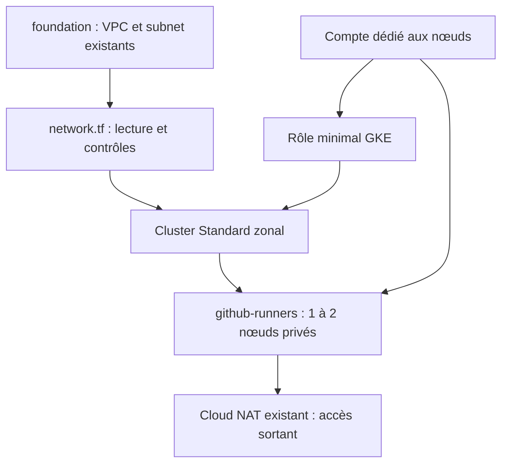

# GKE Standard — cluster des futurs runners GitHub Actions

[Guide principal](../README.md) · [Réseau foundation](../foundation/README.md)

Cette stack indépendante réutilise le réseau foundation. Elle gère le cluster,
un node pool, le compte de service des nœuds et son attribution IAM. Elle ne
crée pas de VPC, subnet, Router, NAT, bucket, Helm release ou runner.

## Comprendre Kubernetes et GKE

| Terme | Explication |
| --- | --- |
| Cluster | Ensemble du control plane et des nœuds qui exécutent les charges. |
| Control plane | Pilotage Kubernetes géré par Google dans GKE. |
| Node pool | Groupe de nœuds ayant une configuration et des règles d'évolution communes. |
| Node | VM Compute Engine exécutant notamment kubelet et les conteneurs des Pods. |
| Pod | Unité d'exécution Kubernetes regroupant un ou plusieurs conteneurs. |
| Service | Point d'accès stable à des Pods ; ClusterIP interne, LoadBalancer pouvant créer une ressource GCP facturable. |

Dans le control plane, **API Server** reçoit les requêtes, **Scheduler** place
les Pods, **Controller Manager** réconcilie les objets et **etcd** conserve l'état
Kubernetes. Google en gère l'exploitation ; nous n'installons pas ces composants
sur une VM supplémentaire. L'état etcd/Kubernetes n'est pas le state Terraform.

En **GKE Standard**, l'équipe choisit zone, machines, pools, disques, capacité et
sécurité. Google gère le control plane et les mécanismes d'exploitation managés.
Nous configurons ensuite les accès, namespaces, workloads et leurs politiques.
Un cluster vide ne signifie pas absence de nœuds ni absence de coût.

## Configuration réelle des fichiers

| Paramètre | DEV | PROD, exemple préparé |
| --- | --- | --- |
| project_id | masterpoulet-dev | masterpoulet-prod |
| cluster_name | masterpoulet-dev-gke | masterpoulet-prod-gke |
| region | europe-west1 | europe-west3 |
| zone | europe-west1-b | europe-west3-b |
| network_name | masterpoulet-dev-vpc | masterpoulet-prod-vpc |
| subnet_name | masterpoulet-dev-vpc-subnet | masterpoulet-prod-vpc-subnet |
| pods_range_name | masterpoulet-dev-vpc-subnet-pods | masterpoulet-prod-vpc-subnet-pods |
| services_range_name | masterpoulet-dev-vpc-subnet-services | masterpoulet-prod-vpc-subnet-services |
| node_service_account_id | masterpoulet-dev-gke-nodes | masterpoulet-prod-gke-nodes |
| node_pool_name | github-runners | github-runners |
| machine_type | e2-standard-2 | e2-standard-2 |
| disk_size_gb / disk_type | 30 / pd-standard | 30 / pd-standard |
| node_autoscaling | min=1, max=2 | min=1, max=2 |
| deletion_protection | false, démonstration | true |

Chaque ligne correspond à une variable de variables.tf. Les validations
contrôlent notamment les IDs, le disque entier d'au moins 30 Go et les bornes
entières 1 <= min <= max. L'autoscaling 1–2 est la **valeur actuelle**, pas une
limite universelle codée pour tous les futurs usages. La précondition du cluster
vérifie que sa zone appartient à la région du subnet.

| Fichier | Rôle et dépendances |
| --- | --- |
| providers.tf / .terraform.lock.hcl | Terraform >=1.6 et <2 ; Google ~>7.0 verrouillé en 7.46.1 ; projet/région/zone explicites. |
| backend.tf / backends/*.hcl | Backend GCS partiel et sélection d'environnement. |
| variables.tf / dev.tfvars / prod.tfvars | Types, validations et valeurs d'environnement. |
| network.tf | Data sources VPC/subnet ; vérifie appartenance au VPC, présence de deux secondaires distinctes et Private Google Access. |
| iam.tf | google_service_account.nodes et google_project_iam_member.nodes. |
| cluster.tf | google_container_cluster.gke ; attend le rôle IAM des nœuds. |
| node-pool.tf | google_container_node_pool.runners ; référence le cluster et le compte des nœuds. |
| outputs.tf | Noms, zone, email de service account et commande get-credentials. |
| .gitignore | Exclut cache, états et plans ; conserve le lock provider. |



### Réseau et sécurité

Le cluster est VPC-native : il utilise les secondaires **existantes**, sans
création automatique de subnet/plage. En DEV, la primaire est 10.0.1.0/24,
les Pods 10.16.0.0/21 et les Services 10.16.8.0/24. Ces valeurs sont détaillées
[dans foundation](../foundation/README.md). PROD doit d'abord recevoir ses
secondaires : elles sont absentes du subnet audité.

Cluster et pool demandent des **nœuds privés**, sans IP publique individuelle.
Le NAT foundation couvre leurs plages ; Private Google Access donne accès aux
API Google prises en charge. Cela n'autorise pas tout trafic entrant. Les
endpoints IP du control plane sont désactivés ; l'endpoint DNS autorise l'accès
utilisateur authentifié via IAM. Les tokens Kubernetes et certificats client
via DNS ne sont pas activés. Les droits IAM et Kubernetes restent nécessaires.

Le compte DEV est
`masterpoulet-dev-gke-nodes@masterpoulet-dev.iam.gserviceaccount.com`, avec le seul
rôle attribué par cette stack **roles/container.defaultNodeServiceAccount** pour
les tâches système GKE. Aucune clé privée ni rôle Editor/Owner n'est créé.
Le scope cloud-platform n'élargit pas les permissions IAM. Les droits de lecture
d'images Artifact Registry privées seront à traiter séparément si nécessaire.

Workload Identity Federation est configurée avec le pool
masterpoulet-dev.svc.id.goog et GKE_METADATA sur les nœuds. Les identités et droits
des futurs Pods restent à configurer : cela ne rend pas tous les jobs autorisés
à GCP. Ce mécanisme diffère de la future fédération GitHub OIDC→GCP.

Autres réglages : COS_CONTAINERD, Shielded Nodes, Secure Boot, surveillance
d'intégrité, Dataplane V2, canal REGULAR, réparation et upgrades automatiques.
Logs/métriques limités aux composants système ; Managed Prometheus et l'addon
HTTP Load Balancing sont désactivés. Les futurs logs de jobs doivent être
consultés via GitHub/runners ou configurés explicitement.

### Capacité et disponibilité

Un seul pool permanent, une seule zone, aucun GPU et pas de Spot. Le pool a
32 Pods maximum par nœud, incluant les Pods système ; cette limite ne garantit
pas que la CPU/mémoire d'une e2-standard-2 suffise à 32 jobs. Les demandes de
ressources des futurs runners devront être adaptées.

L'initial_node_count démarre à 1 ; le lifecycle ignore ses variations ultérieures
pour laisser l'autoscaler agir sans recréer le pool. min_node_count=1 et
max_node_count=2 s'appliquent par zone ; comme une seule zone est sélectionnée,
il s'agit ici d'un total de 1 à 2 nœuds.

Les upgrades ont **max_surge=0, max_unavailable=1** : pas de nœud supplémentaire
pour la mise à niveau, mais des jobs peuvent être interrompus, surtout avec un
seul nœud. Le cluster zonal ne fournit pas une disponibilité multi-zone. Prévoir
jobs relançables et fenêtres de maintenance avec l'équipe.

GKE crée brièvement un pool initial avant que remove_default_node_pool=true le
supprime. cluster.tf lui applique aussi une petite configuration privée et le
compte dédié. Cette VM/disque temporaire peut être facturée ; seul github-runners
reste ensuite. Il n'y a pas de second pool permanent.

## State, statut observé et historique

| Cible | Couple | Bucket / préfixe |
| --- | --- | --- |
| DEV | backends/dev.hcl + dev.tfvars | masterpoulet_bucket / gke/dev |
| PROD | backends/prod.hcl + prod.tfvars | masterpoulet_prod_bucket / gke/prd |

Workspace default, objets gke/dev/default.tfstate et gke/prd/default.tfstate.
Les fichiers PROD s'appellent désormais prod.tfvars et backends/prod.hcl ; le
préfixe historique gke/prd reste volontairement inchangé. Ce renommage de fichiers
ne migre pas le state et ne modifie aucune ressource GCP.
Le réseau garde son state foundation indépendant. GKE ne possède que quatre
ressources managées ; les deux lectures réseau sont des data sources.

**Audit du 23 octobre 2026 en lecture seule** : cluster DEV RUNNING dans
**europe-west1-b**, un nœud observé ; pool github-runners RUNNING, autoscaling
activé 1–2, e2-standard-2, disque 30 Go pd-standard, nœuds privés et compte dédié.
Les endpoints IP sont désactivés, le DNS autorisé et Workload Identity actif.
Les quatre ressources sont présentes dans le state DEV. L'audit n'a pas vérifié
la santé via kubectl, les Pods applicatifs ou une montée/descente de charge.

En PROD, l'API GKE est désactivée : l'inventaire a échoué, ce qui **ne prouve pas**
l'absence d'un cluster. Aucun objet trouvé sous gke/prd ; la configuration et la
zone europe-west3-b restent un exemple à revoir. Prévoir secondaires, API, agents
de service, quotas et permissions avant tout déploiement PROD.

À la préparation initiale, l'API DEV était désactivée et le plan proposait
4 créations. Après un échec de création lié à node_locations, le compte et son
IAM étaient déjà dans le state ; le plan corrigé proposait 2 créations, sans
modifier ces identités. Depuis, le cluster est déployé. Ces anciens résultats
ne remplacent pas un plan frais ; aucun nouveau plan n'a été lancé pour ce guide.
Les anciens constats « API DEV désactivée » et « state DEV vide » sont historiques.

## Préparer un plan DEV

Les [installations et connexions communes](../README.md#préparer-windows-et-les-identités)
précèdent ces commandes, lancées depuis la racine du dépôt :

```powershell
Set-Location infra/gke
terraform init -reconfigure -backend-config="backends/dev.hcl" -input=false
if ($LASTEXITCODE -ne 0) { throw 'Échec backend GKE DEV.' }
$gkeWorkspace = terraform workspace show
if ($LASTEXITCODE -ne 0 -or $gkeWorkspace -ne 'default') { throw 'Workspace default requis.' }
terraform fmt -check -recursive
if ($LASTEXITCODE -ne 0) { throw 'Format incorrect.' }
terraform validate
if ($LASTEXITCODE -ne 0) { throw 'Configuration invalide.' }
terraform plan -var-file="dev.tfvars" -input=false -lock-timeout=60s -out="dev-gke.tfplan"
if ($LASTEXITCODE -ne 0) { throw 'Échec plan GKE DEV.' }
terraform show dev-gke.tfplan
terraform state list
terraform output
```

Sur un déploiement aligné, attendre No changes ; investiguer tout remplacement
ou IAM inattendu. Sur une stack vide, quatre créations sont définies. Le plan ne
garantit pas tous les droits de création : le premier plan avait pu réussir
sans API GKE activée. Les stacks n'activent aucune API et ne créent pas de bucket.
Vérifier notamment container.googleapis.com, les droits GKE/IAM/actAs et quotas.

Pour une application ultérieure, utiliser [la procédure contrôlée](../README.md#planifier-et-déployer).
Ne pas appliquer un ancien dev-gke.tfplan trouvé sur le PC. Conserver les états
après un échec partiel et refaire un plan au lieu de recréer manuellement les comptes.

| Output | Usage |
| --- | --- |
| cluster_name | Nom du cluster. |
| cluster_location | Zone unique. |
| node_pool_name | Nom du pool runners. |
| node_service_account_email | Identité des nœuds, sans clé privée. |
| get_credentials_command | Commande de connexion utilisant le DNS et le projet explicite. |

## Se connecter depuis un nouveau PC Windows

Installer Google Cloud CLI officiel, kubectl et le plugin selon
[le guide commun](../README.md#préparer-windows-et-les-identités). Si seul gcloud
est installé, ajouter les composants :

```powershell
gcloud.cmd components install kubectl gke-gcloud-auth-plugin
if ($LASTEXITCODE -ne 0) { throw 'Installation incomplète.' }
gke-gcloud-auth-plugin --version
kubectl version --client
gcloud.cmd auth login
if ($LASTEXITCODE -ne 0) { throw 'Connexion Google échouée.' }
gcloud.cmd auth list
```

Utiliser son propre compte disposant d'accès GKE, de la permission
container.clusters.connect pour l'endpoint DNS et des autorisations Kubernetes
voulues. Les permissions IAM/RBAC des trois développeurs ne sont pas créées par
cette stack. Un administrateur doit les attribuer au bon périmètre ; aucun besoin
de donner Owner à tous. ADC est nécessaire pour Terraform, pas pour simplement
exécuter cette connexion kubectl avec le compte gcloud par défaut.

Récupérer la configuration du **cluster DEV** :

```powershell
gcloud.cmd container clusters get-credentials masterpoulet-dev-gke --project=masterpoulet-dev --zone=europe-west1-b --dns-endpoint
if ($LASTEXITCODE -ne 0) { throw 'Impossible de configurer la connexion GKE.' }
kubectl config current-context
kubectl get nodes
kubectl get pods -n kube-system
kubectl get namespaces
```

La commande get-credentials crée/met à jour l'entrée locale **kubeconfig**, par
défaut dans le fichier .kube/config du profil utilisateur ; KUBECONFIG peut
changer ce chemin. Le contexte sélectionne cluster, endpoint et méthode
d'authentification. Ne pas committer ce fichier ni le copier entre développeurs.
Le plugin obtient les credentials nécessaires sans partager une clé statique.

Vérifier le contexte avant toute opération kubectl : d'autres clusters peuvent
être mémorisés sur le même PC. --dns-endpoint est important puisque les endpoints
IP sont désactivés. L'accès exige une connectivité Internet/DNS/HTTPS appropriée,
mais ne nécessite pas un bastion ni que le PC du créateur soit allumé. Chaque
membre se connecte **directement à GCP avec son compte et ses permissions**.

Dans la console, choisir masterpoulet-dev puis **Kubernetes Engine → Clusters** :
ouvrir masterpoulet-dev-gke, regarder la zone, les paramètres réseau et la
sécurité, puis l'onglet **Nodes** pour les nœuds et le pool github-runners.
Selon la version de l'interface, la navigation Node pools est présentée dans
les détails du cluster. La console ne remplace pas un test des droits kubectl.

## Exploitation et autoscaling

Contrôles de santé en lecture seule, après vérification du contexte DEV :

```powershell
kubectl get nodes -o wide
kubectl get nodes -L cloud.google.com/gke-nodepool
kubectl get pods -n kube-system
kubectl get namespaces
kubectl get events -A --sort-by=.lastTimestamp
kubectl auth can-i list pods --namespace=kube-system
gcloud.cmd container node-pools describe github-runners --cluster=masterpoulet-dev-gke --zone=europe-west1-b --project=masterpoulet-dev --format='yaml(status,locations,autoscaling,config.machineType,config.diskSizeGb,config.diskType,networkConfig,upgradeSettings)'
```

Les nœuds devraient être Ready ; examiner Pods Pending, CrashLoopBackOff et les
events plutôt que de relancer des déploiements au hasard. Certains Pods de type
Job terminés peuvent normalement être Completed. get nodes -o wide permet
également de contrôler l'absence d'IP publique ; un statut GCP RUNNING ne suffit
pas à démontrer cette santé Kubernetes.

**Autoscaling configuré** signifie que le pool accepte de passer de 1 à 2 nœuds.
**Autoscaling démontré** exige un test documenté : charge avec requests réalistes,
Pods Pending faute de ressources, ajout du second nœud, puis retrait après baisse
de charge et délai. Aucun tel test n'a été effectué pour cette documentation.
L'autoscaler ne connaît pas directement la file GitHub : les futurs runners
créent la demande de Pods, puis le cluster autoscaler réagit à leur planification.
Avec min=1, il ne supprimera pas le dernier nœud à vide.

## Helm et runners : prochaines étapes

**Helm** est un gestionnaire de packages Kubernetes : un chart décrit des objets
et des paramètres ; une release représente une installation. Il ne remplace ni
Terraform pour le réseau/cluster, ni Kubernetes pour l'exécution des Pods.

Le **Kubernetes Controller Manager** est un composant du control plane managé.
L'**Actions Runner Controller (ARC)** est un autre contrôleur, à installer dans
le cluster pour orchestrer des runners GitHub Actions. Ils ne remplissent pas
le même rôle et ARC n'est pas fourni par la simple création d'un cluster GKE.

Aucun chart Helm, installation ARC, identité GitHub de runner, runner scale set
ou liaison de workflow vers ces runners n'est défini dans les stacks auditées.
Les workloads du cluster n'ont pas été inventoriés via kubectl pendant l'audit :
ne pas en déduire qu'une installation manuelle existe ou n'existe pas.

Étapes futures à préparer dans une tâche distincte :

1. Choisir et vérifier les versions Helm/ARC et la méthode d'authentification GitHub, en gérant les secrets hors Git.
2. Définir namespaces, permissions, isolation des jobs et identités de workloads. Exécuter du code de PR non fiable nécessite une conception spécifique.
3. Installer le contrôleur et le runner scale set, avec requests/limits adaptés aux petites VM.
4. Définir des labels de runners et un workflow de test ciblé ; ne pas migrer tous les workflows d'un coup.
5. Démontrer la création/suppression de runners puis le passage de 1 à 2 nœuds, et mesurer le coût.

Le cluster sert à **exécuter les jobs de CI**, pas à héberger l'application
serverless. Les workflows actuels qui publient les images GHCR et les contrôles
Terraform ne démontrent pas une exécution sur ce pool. OIDC GitHub→GCP reste
également distinct de Workload Identity déjà configurée dans GKE.

## Détruire GKE pour économiser

Après la démonstration, le dernier nœud reste facturé même si les runners sont
inactifs. Voir [les coûts communs](../README.md#coûts-et-économies). Les quatre
ressources managées de cette stack sont supprimables indépendamment du réseau.
Les ressources techniques créées par GKE, telles que les VM du pool, suivent le
cycle de vie du cluster ; des disques/Services futurs peuvent avoir une autre
politique de conservation.

Avant suppression du cluster partagé : accord de l'équipe, arrêt des jobs,
sauvegarde des données, inventaire des PVC/PV, Services LoadBalancer, Ingress,
IP et intégrations GitHub. Examiner les obligations de conservation. Depuis
infra/gke, réinitialiser explicitement DEV puis préparer le plan :

```powershell
terraform init -reconfigure -backend-config="backends/dev.hcl" -input=false
if ($LASTEXITCODE -ne 0) { throw 'Échec backend GKE DEV.' }
$gkeWorkspace = terraform workspace show
if ($LASTEXITCODE -ne 0 -or $gkeWorkspace -ne 'default') { throw 'Workspace default requis.' }
terraform plan -destroy -var-file="dev.tfvars" -input=false -lock-timeout=60s -out="dev-gke-destroy.tfplan"
if ($LASTEXITCODE -ne 0) { throw 'Échec plan de nettoyage.' }
terraform show dev-gke-destroy.tfplan
```

Ce plan ne supprime rien. Vérifier qu'il vise cluster, pool, compte dédié et son
attribution IAM, **aucune ressource foundation**. Après revue et coordination,
la suppression réelle peut être confirmée manuellement :

```powershell
$gkeConfirmation = Read-Host 'Supprimer GKE DEV après revue ? Saisir SUPPRIMER'
if ($gkeConfirmation -cne 'SUPPRIMER') { throw 'Suppression annulée.' }
terraform apply dev-gke-destroy.tfplan
if ($LASTEXITCODE -ne 0) { throw 'Suppression incomplète : examiner le state.' }
terraform state list
gcloud.cmd container clusters list --project=masterpoulet-dev
```

L'application d'un plan enregistré ne demande pas un second yes. Cette procédure
est documentaire et n'a pas été exécutée lors de sa rédaction. En PROD,
deletion_protection=true bloque le nettoyage : une modification revue et appliquée
de ce réglage est nécessaire au préalable. Ne pas retirer le state pour contourner
la protection.

Après suppression, vérifier Compute Engine, disques, IP et load balancers.
Foundation, NAT et buckets restent et peuvent avoir des coûts. Ne pas supprimer
leurs states. Pour recréer : vérifier foundation, refaire init/validate et un
nouveau plan GKE, l'appliquer après revue, renouveler get-credentials, puis
réinstaller les futurs workloads/Helm selon leur propre procédure. Aucun ancien
plan binaire ne doit être réutilisé après un nettoyage.

## Diagnostic Kubernetes

| Erreur / symptôme | Vérification et correction |
| --- | --- |
| gke-gcloud-auth-plugin absent | Installer le composant gcloud, vérifier PATH et --version ; rouvrir PowerShell. |
| Get-credentials 403 / cluster invisible | Contrôler compte, projet et zone, API activée, permissions GKE et container.clusters.connect. |
| Timeout / DNS introuvable | Vérifier Internet, DNS, proxy/firewall local et contexte ; refaire get-credentials avec --dns-endpoint. Ne pas exposer une IP publique de contrôle pour contourner. |
| Unauthorized | Vérifier auth login et le plugin, puis renouveler le contexte. |
| Forbidden | L'authentification fonctionne mais l'autorisation manque ; vérifier IAM et RBAC pour le namespace/objet, via auth can-i. |
| Plages secondaires absentes | Lire le subnet dans la bonne région ; faire revoir/appliquer séparément foundation, sans créer des plages de remplacement dans GKE. |
| Apply partiellement réussi | Lire state list/show ; garder comptes/IAM déjà gérés, corriger puis refaire un plan. |
| Nœud privé sans sortie | Vérifier NAT, subnet couvert, routes, règles de sortie et Private Google Access ; ne pas attribuer une IP publique au hasard. |
| Cluster RUNNING mais Pods en erreur | Examiner Ready, events, ressources CPU/mémoire et images ; le statut GCP seul n'est pas une preuve de santé. |

### Erreur node_locations

Erreur rencontrée :

```text
when using a multi-zonal cluster, node_locations should not contain the original 'zone'
```

Pour un **cluster zonal**, location=var.zone fixe la zone principale ; définir
node_locations au niveau cluster sert à demander des zones supplémentaires et
ne doit pas répéter cette zone. La correction actuelle dans cluster.tf est :

```hcl
location = var.zone
# Aucune ligne node_locations au niveau du cluster.
```

Dans le **node pool**, node_locations=[var.zone] est correct : il limite ses VM
à europe-west1-b. Ne pas remplacer la zone du cluster par une région, ce qui
changerait l'architecture et pourrait multiplier les nœuds par défaut. Le plan
corrigé avait conservé google_service_account.nodes et google_project_iam_member.nodes
sans changement. L'absence de node_locations dans le code cluster n'empêche pas
GKE de retourner un champ calculé après création.

Références : [accès kubectl et plugin](https://docs.cloud.google.com/kubernetes-engine/docs/how-to/cluster-access-for-kubectl),
[commande get-credentials](https://docs.cloud.google.com/sdk/gcloud/reference/container/clusters/get-credentials),
[compte des nœuds](https://docs.cloud.google.com/kubernetes-engine/security/configure-node-service-accounts),
[cluster Terraform](https://registry.terraform.io/providers/hashicorp/google/7.46.1/docs/resources/container_cluster),
[node pool Terraform](https://registry.terraform.io/providers/hashicorp/google/7.46.1/docs/resources/container_node_pool).
